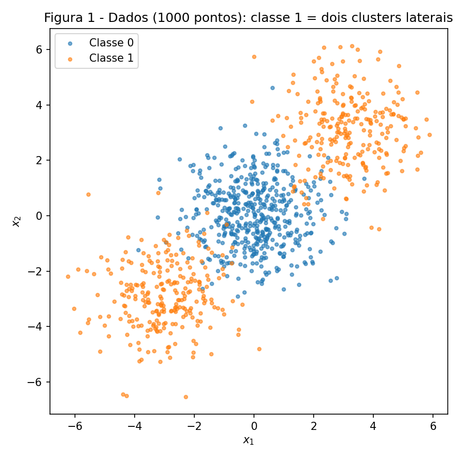
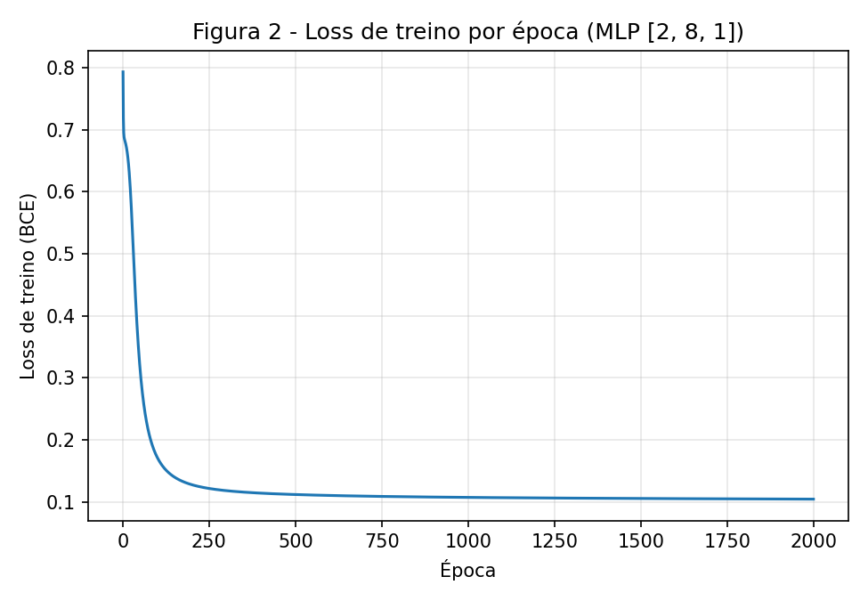
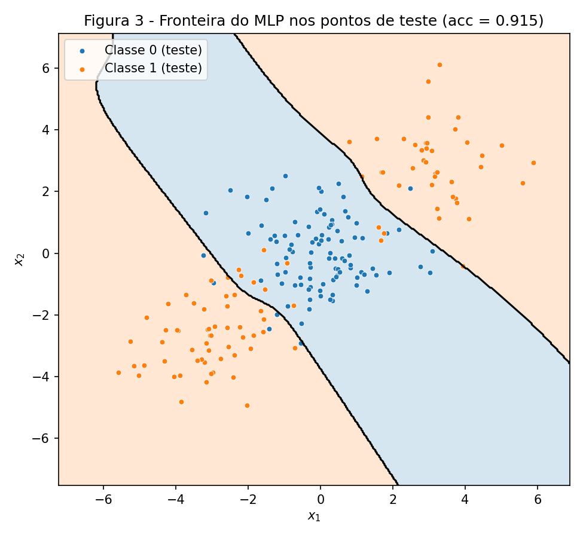
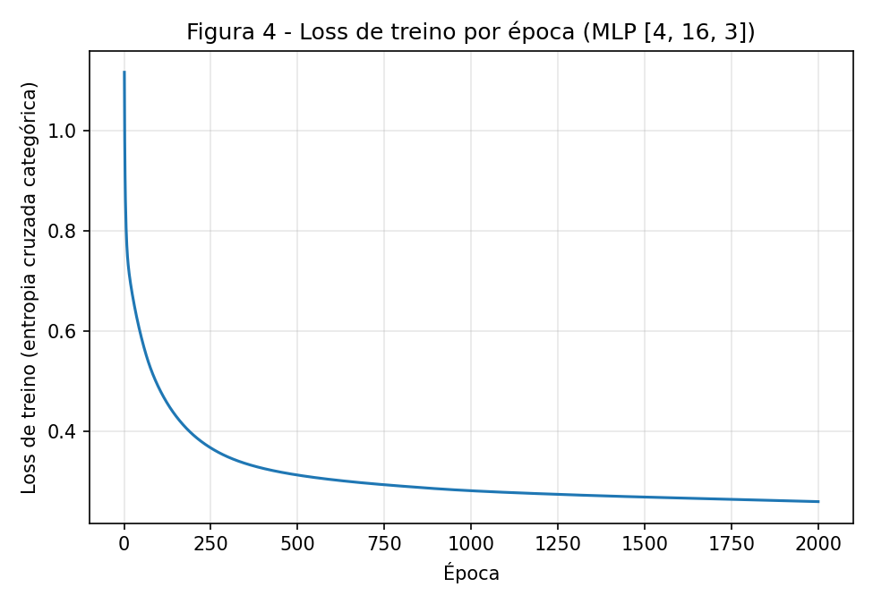
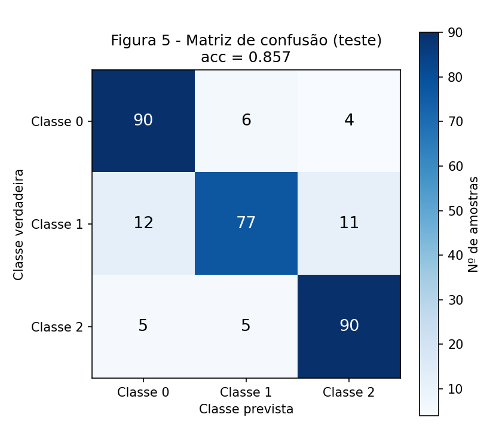
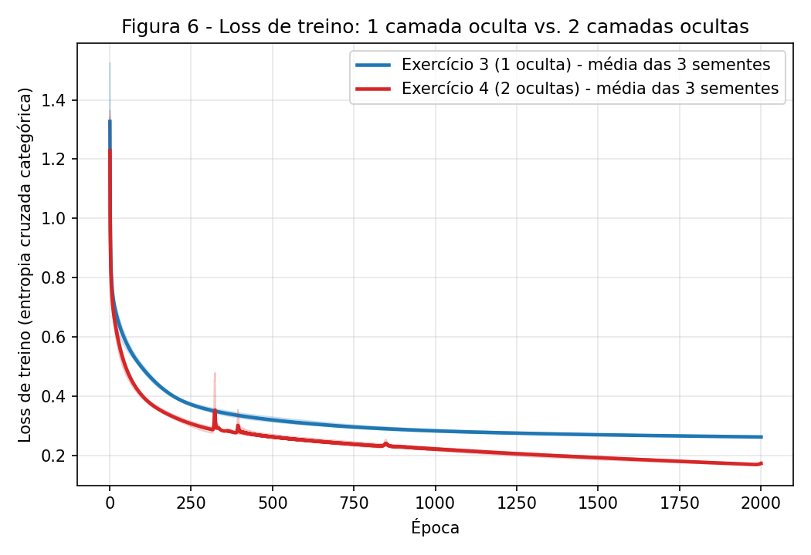

exercise: mlp
ai_use: "Claude foi usado para implementar o MLP do zero e os scripts dos experimentos a partir do enunciado, e para redigir a primeira versão da derivação do Exercício 1 e das análises. Todos os números do relatório vêm da execução dos scripts do repositório (a derivação à mão do Exercício 1 foi conferida por um script aritmético sem bibliotecas de ML, e os gradientes do MLP foram conferidos por diferenças finitas)."
---

# 3. MLP

!!! abstract "Enunciado"

    [Exercises → MLP](https://insper.github.io/ann-dl/2026.2/exercises/mlp/){:target='_blank'}

## Exercise 1

### Abordagem

Um passo completo de *backpropagation* à mão, em Markdown, para a rede 2–2–1 com `tanh` nas duas
camadas e $L=(y-\hat y)^2$ (com $N=1$). Notação do enunciado: $W\equiv W^{(1)}$, $V\equiv W^{(2)}$,
$b^h\equiv b^{(1)}$, $b^y\equiv b^{(2)}$. Cada linha de $W$ é um neurônio oculto, ou seja,
$z^{(1)}_j=\sum_i W_{ji}x_i+b^h_j$. Valores: $\mathbf x=[0.5,-0.2]$, $y=1$,
$W=\begin{bmatrix}0.3&-0.1\\0.2&0.4\end{bmatrix}$, $b^h=[0.1,-0.2]$, $V=[0.5,-0.3]$, $b^y=0.2$, $\eta=0.3$.
Os números abaixo foram conferidos com um script de aritmética pura (`math.tanh`, sem biblioteca de ML).

### Código

O script abaixo **não** é a resolução: a resolução está nas contas desta seção. Ele só reexecuta as mesmas
contas, na mesma ordem, para conferir cada valor.

``` { .python .copy .select linenums='1' title="docs/exercises/mlp/code/exercise1_backprop_check.py" }
--8<-- "docs/exercises/mlp/code/exercise1_backprop_check.py"
```

### Figuras

Este exercício não pede figuras.

### Análise

#### A — Forward pass

Pré-ativação da camada oculta:

$$
z^{(1)}_1 = 0.3(0.5)+(-0.1)(-0.2)+0.1 = 0.15+0.02+0.1 = 0.2700
$$

$$
z^{(1)}_2 = 0.2(0.5)+0.4(-0.2)+(-0.2) = 0.10-0.08-0.2 = -0.1800
$$

Ativação oculta:

$$
h^{(1)}_1=\tanh(0.2700)=0.263625,\qquad h^{(1)}_2=\tanh(-0.1800)=-0.178081
$$

Saída:

$$
u^{(2)} = 0.5(0.263625)+(-0.3)(-0.178081)+0.2 = 0.131812+0.053424+0.2 = 0.385237
$$

$$
\hat y=\tanh(0.385237)=0.367247,\qquad L=(1-0.367247)^2=0.632753^2=0.400377
$$

**Resultado:** $z^{(1)}=[0.2700,\,-0.1800]$, $h^{(1)}=[0.2636,\,-0.1781]$, $u^{(2)}=0.3852$, $\hat y=0.3672$, $L=0.4004$.

#### B — Backward pass

**Saída.** Da definição da loss, $\partial L/\partial\hat y=-2(y-\hat y)=-2(0.632753)=-1.265507$. Como
$\hat y=\tanh(u^{(2)})$ e $\tanh'(u)=1-\tanh^2(u)$:

$$
\frac{\partial\hat y}{\partial u^{(2)}}=1-\hat y^2=1-0.134872=0.865128
$$

$$
\frac{\partial L}{\partial u^{(2)}}=\frac{\partial L}{\partial \hat y}\frac{\partial \hat y}{\partial u^{(2)}}
=(-1.265507)(0.865128)=-1.094828
$$

Como $u^{(2)}=V_1h_1+V_2h_2+b^y$, os gradientes da camada de saída são $\partial L/\partial V_k=\frac{\partial L}{\partial u^{(2)}}h_k$
e $\partial L/\partial b^y=\frac{\partial L}{\partial u^{(2)}}$:

$$
\frac{\partial L}{\partial V_1}=(-1.094828)(0.263625)=-0.288624,\qquad
\frac{\partial L}{\partial V_2}=(-1.094828)(-0.178081)=0.194968
$$

$$
\frac{\partial L}{\partial b^y}=-1.094828
$$

**Propagação para a camada oculta.** $\partial L/\partial h_k=\frac{\partial L}{\partial u^{(2)}}V_k$:

$$
\frac{\partial L}{\partial h_1}=(-1.094828)(0.5)=-0.547414,\qquad
\frac{\partial L}{\partial h_2}=(-1.094828)(-0.3)=0.328448
$$

Com $h_k=\tanh(z_k)$, $\partial h_k/\partial z_k=1-h_k^2$: $1-0.263625^2=0.930502$ e $1-(-0.178081)^2=0.968287$. Logo

$$
\frac{\partial L}{\partial z^{(1)}_1}=(-0.547414)(0.930502)=-0.509370,\qquad
\frac{\partial L}{\partial z^{(1)}_2}=(0.328448)(0.968287)=0.318032
$$

**Gradientes de $W^{(1)}$ e $b^{(1)}$.** Como $z_j=\sum_i W_{ji}x_i+b^h_j$, vale $\partial L/\partial W_{ji}=\frac{\partial L}{\partial z_j}x_i$ e
$\partial L/\partial b^h_j=\frac{\partial L}{\partial z_j}$:

$$
\frac{\partial L}{\partial W}=
\begin{bmatrix}
(-0.509370)(0.5) & (-0.509370)(-0.2)\\
(0.318032)(0.5) & (0.318032)(-0.2)
\end{bmatrix}=
\begin{bmatrix}-0.254685 & 0.101874\\ 0.159016 & -0.063606\end{bmatrix}
$$

$$
\frac{\partial L}{\partial b^h}=[-0.509370,\;0.318032]
$$

#### C — Atualização ($\eta=0.3$)

Regra: $\theta\leftarrow\theta-\eta\,\partial L/\partial\theta$.

| Parâmetro | Antes | Gradiente | Depois |
|---|---|---|---|
| $W_{11}$ | 0.3000 | −0.254685 | $0.3+0.3(0.254685)=$ **0.376405** |
| $W_{12}$ | −0.1000 | 0.101874 | $-0.1-0.3(0.101874)=$ **−0.130562** |
| $W_{21}$ | 0.2000 | 0.159016 | $0.2-0.3(0.159016)=$ **0.152295** |
| $W_{22}$ | 0.4000 | −0.063606 | $0.4+0.3(0.063606)=$ **0.419082** |
| $b^h_1$ | 0.1000 | −0.509370 | $0.1+0.3(0.509370)=$ **0.252811** |
| $b^h_2$ | −0.2000 | 0.318032 | $-0.2-0.3(0.318032)=$ **−0.295410** |
| $V_1$ | 0.5000 | −0.288624 | $0.5+0.3(0.288624)=$ **0.586587** |
| $V_2$ | −0.3000 | 0.194968 | $-0.3-0.3(0.194968)=$ **−0.358490** |
| $b^y$ | 0.2000 | −1.094828 | $0.2+0.3(1.094828)=$ **0.528448** |

(A rede tem 9 parâmetros escalares: $W$ (4) + $b^h$ (2) + $V$ (2) + $b^y$ (1). O enunciado fala em "oito", mas a tabela
reporta os nove, o que cobre qualquer contagem.)

**A loss vai subir ou descer?** **Descer.** O gradiente descendente move os parâmetros na direção oposta ao gradiente,
e para um passo suficientemente pequeno isso reduz $L$ (expansão de primeira ordem:
$\Delta L\approx-\eta\|\nabla L\|^2<0$). Conferi com uma segunda passada forward usando os parâmetros novos:
$\hat y=0.711181$ e $L=0.083417$, contra $\hat y=0.367247$ e $L=0.400377$ antes. A loss caiu de 0.4004 para 0.0834, e
$\hat y$ se aproximou do alvo $y=1$. Isso é coerente com $\eta=0.3$ ser pequeno o bastante para a aproximação linear valer
nesse ponto (um $\eta$ grande demais poderia ultrapassar o mínimo e fazer a loss subir).

## Exercise 2

### Abordagem

Dados gerados exatamente como no enunciado (`make_blobs` com `centers=[[0,0],[3,3],[-3,-3]]`,
`n_samples=[500,250,250]`, `cluster_std=1.2`, `random_state=42`; $y=(c>0)$), com split 80/20 estratificado
(800 treino / 200 teste). Baseline: `LogisticRegression`. O MLP é o de `mlp.py`, escrito do zero em numpy:
camadas ocultas `tanh`, saída sigmoide com entropia cruzada binária (BCE), gradientes derivados à mão
(sem autodiff) e gradiente descendente em lote completo. Os tamanhos das camadas são um argumento
(`MLP([2, 8, 1], ...)`), e o mesmo arquivo é usado sem alterações nos Exercícios 3 e 4.

**Gradiente da saída.** Com $p=\sigma(u)$, $\sigma'(u)=p(1-p)$ e $L=-[y\log p+(1-y)\log(1-p)]$:

$$
\frac{\partial L}{\partial u}=\Big(-\frac{y}{p}+\frac{1-y}{1-p}\Big)p(1-p)=-y(1-p)+(1-y)p=p-y
$$

Na média sobre $N$ amostras, $\delta^{\text{saída}}=(p-y)/N$. Para as camadas anteriores, o `backward()`
aplica a regra da cadeia: $\partial L/\partial W^{(l)}=a^{(l-1)\top}\delta^{(l)}$, $\partial L/\partial b^{(l)}=\sum\delta^{(l)}$,
$\delta^{(l-1)}=(\delta^{(l)}W^{(l)\top})\odot(1-a^{(l-1)2})$. Conferi esses gradientes por diferenças finitas
(erro máximo ≈ $6\times10^{-11}$ para sigmoide e ≈ $1\times10^{-10}$ para softmax).

### Código

``` { .python .copy .select linenums='1' title="docs/exercises/mlp/code/mlp.py" }
--8<-- "docs/exercises/mlp/code/mlp.py"
```

``` { .python .copy .select linenums='1' title="docs/exercises/mlp/code/exercise2_mlp.py" }
--8<-- "docs/exercises/mlp/code/exercise2_mlp.py"
```

1. Xavier ($W\sim\mathcal N(0,1/n_{in})$) é a inicialização adequada para `tanh`: mantém as pré-ativações em
   uma faixa onde a derivada não é quase zero.
2. `delta = (out - Y) / N` vale tanto para sigmoide+BCE quanto para softmax+entropia cruzada categórica
   (derivação no Exercício 3), e é isso que permite reutilizar `backward()` sem mudanças.

### Figuras


/// caption
**Figura 1** — Os 1000 pontos coloridos por $y$: a classe 1 são os dois clusters laterais, e a classe 0 fica no meio.
///


/// caption
**Figura 2** — Loss de treino (BCE) por época: de 0.7930 para 0.1043 em 2000 épocas.
///


/// caption
**Figura 3** — Fronteira de decisão do MLP sobre os pontos de teste (regiões sombreadas avaliadas em uma grade 400×400).
///

### Análise

**B — Baseline linear.** A `LogisticRegression` atinge **47.50%** de acurácia de teste (95/200). Os coeficientes
aprendidos são praticamente nulos ($w=[0.0296,\,0.0015]$, $b=-0.0031$) e o modelo prevê classe 1 para apenas 44.5% do teste.
Vale uma ressalva honesta: com 200 amostras, o erro-padrão de uma acurácia em torno de 50% é de cerca de 3.5 pontos
percentuais, então 47.5% é estatisticamente indistinguível de 50%. O que o resultado mostra é que o baseline
**não aprende nada útil**, e não que ele seja sistematicamente pior que o acaso.

**C — MLP do zero.** Arquitetura **2–8–1** (uma camada oculta com 8 neurônios `tanh`, saída sigmoide; 33 parâmetros),
$\eta=0.5$, **2000 épocas**, lote completo, sementes fixas (`default_rng(42)`). Resultado: acurácia de treino 96.75% e
**acurácia de teste 91.50%**, dentro da faixa esperada (90–93%). A loss de treino cai de 0.7930 para 0.1043
(Figura 2).

**D — Por que a reta fica abaixo (ou em torno) de 50% e o MLP passa de 90%.** A distribuição dos dados é simétrica
em relação à origem: as classes são "um cluster em (0,0)" e "dois clusters em $\pm(3,3)$", e trocar $\mathbf x$ por $-\mathbf x$
leva o conjunto de dados nele mesmo. Um modelo linear tem logit $w\cdot\mathbf x+b$, que é uma função *ímpar* em $\mathbf x$
(mais uma constante), enquanto a probabilidade verdadeira $P(y=1\mid\mathbf x)$ é uma função *par*. Como a loss da regressão
logística é convexa e simétrica em $w\to-w$ nesses dados, seu mínimo está em $w\approx 0$ (é o que se observa), e o
modelo degenera para "sempre prever a mesma classe", com acurácia ≈ proporção de classes ≈ 50%. Geometricamente, os dois
clusters da classe 1 ficam em lados *opostos* da classe 0: qualquer reta divide o plano em dois semiplanos, e para
acertar um cluster de classe 1 ela jogaria o outro para o mesmo lado da classe 0.

Na Figura 3, a região atribuída à classe 1 (laranja) tem **duas partes desconectadas**: o canto superior direito e o canto
inferior esquerdo, separadas por uma faixa diagonal azul (classe 0) que passa pela origem e corre do canto superior esquerdo ao
inferior direito. Uma região assim não é convexa nem conexa, e nenhum semiplano é assim. O MLP produz essa faixa
combinando neurônios `tanh`: cada neurônio oculto contribui com uma "reta suavizada", e a camada de saída combina essas
retas, de modo que a fronteira é formada por duas bordas quase paralelas, ligeiramente curvas, nos dois lados do cluster
central. Os erros restantes (8.5% no teste) se concentram nas bordas dessa faixa, onde as caudas das gaussianas
(desvio-padrão 1.2, centros a 4.2 de distância) se sobrepõem de fato, então parte deles é irredutível.

## Exercise 3

### Abordagem

Dados de `make_classification` como no enunciado (1500 amostras, 4 features informativas, 3 classes, 2 clusters por classe,
`class_sep=1.0`, `random_state=42`), com split 80/20 estratificado com a mesma semente (1200 treino / 300 teste).
**Ponto extra (reuso verbatim):** o arquivo `mlp.py` é exatamente o mesmo do Exercício 2, sem nenhuma linha alterada.
Só mudam o tamanho da saída (3 unidades), a função de saída/loss (softmax + entropia cruzada categórica, selecionadas pelo
argumento `output="softmax"`) e os hiperparâmetros.

**Derivação de $\partial L/\partial u$ para softmax + entropia cruzada categórica.** Para uma amostra, com $p_k=e^{u_k}/\sum_j e^{u_j}$
e alvo one-hot $Y$ ($\sum_kY_k=1$): $L=-\sum_kY_k\log p_k$. A derivada do softmax é $\partial p_k/\partial u_j=p_k(\delta_{kj}-p_j)$. Então

$$
\frac{\partial L}{\partial u_j}=-\sum_k\frac{Y_k}{p_k}\,p_k(\delta_{kj}-p_j)
=-\sum_kY_k(\delta_{kj}-p_j)=-Y_j+p_j\underbrace{\sum_kY_k}_{=1}=p_j-Y_j
$$

Ou seja, $\partial L/\partial\mathbf u=\mathbf p-\mathbf Y$, a mesma forma "saída − alvo" do caso binário (sigmoide + BCE).
Na média sobre $N$ amostras, divide-se por $N$. É por isso que `backward()` não precisa mudar.

### Código

O modelo é o `mlp.py` mostrado no Exercício 2 (idêntico). O script do experimento:

``` { .python .copy .select linenums='1' title="docs/exercises/mlp/code/exercise3_mlp.py" }
--8<-- "docs/exercises/mlp/code/exercise3_mlp.py"
```

### Figuras


/// caption
**Figura 4** — Loss de treino (entropia cruzada categórica) por época: de 1.1166 para 0.2597.
///


/// caption
**Figura 5** — Matriz de confusão no conjunto de teste (linhas = classe verdadeira, colunas = prevista).
///

### Análise

**C — Resultados.** Arquitetura **4–16–3** (uma oculta com 16 neurônios `tanh`, saída softmax; 131 parâmetros), $\eta=0.5$,
**2000 épocas**, lote completo, `default_rng(42)`. Loss de treino final 0.2597, acurácia de treino 90.50% e
**acurácia de teste 85.67%** (dentro da faixa esperada, 83–86%).

**D — Par mais confundido.** Pela Figura 5, as confusões entre pares de classes (somando os dois sentidos) são:
classes 0 e 1: $6+12=18$; classes 1 e 2: $11+5=16$; classes 0 e 2: $4+5=9$. O **par mais confundido é (0, 1)**, com 18 erros,
seguido de perto por (1, 2). A classe 1 é a mais difícil (77 acertos em 100, contra 90 das classes 0 e 2) e erra para ambas
as vizinhas. Isso é consistente com a estrutura dos dados: são 6 clusters (2 por classe) em um espaço de 4 dimensões
informativas, com `class_sep=1.0`, o que significa que os clusters são colocados em vértices de um hipercubo de lado 2 e
depois deformados por transformações lineares aleatórias. Com 6 clusters em apenas 4 dimensões e essa deformação, clusters de
classes diferentes se sobrepõem em regiões do espaço, e os erros se concentram onde essas sobreposições ocorrem. Uma
ressalva: o gerador não devolve as posições dos centros, então esta explicação é uma interpretação coerente com a matriz de
confusão, e não uma distância entre centros que eu tenha medido.

**Baseline linear.** A `LogisticRegression` multiclasse atinge **66.33%** de acurácia de teste (≈ 66%, como esperado), contra
**85.67%** do MLP, uma diferença de **+19.3 pontos percentuais**. O que a camada oculta adicionou: com cada classe composta por
**dois clusters em posições diferentes**, a região de cada classe é a união de duas regiões separadas. Um classificador softmax
linear só produz três regiões convexas (cada uma é um poliedro), então não consegue cobrir, para uma mesma classe, dois clusters
distantes com outra classe entre eles. A camada oculta aprende uma representação não linear das entradas na qual essas regiões
passam a ser separáveis por fronteiras lineares na saída.

## Exercise 4

### Abordagem

Mesmos dados, mesmo split, mesmo $\eta=0.5$, mesmas 2000 épocas, mesmo `mlp.py`. **Muda só a profundidade**: Exercício 3 =
4–16–3 (1 oculta), Exercício 4 = 4–16–16–3 (2 ocultas de 16 neurônios). Cada modelo foi treinado com **3 sementes de inicialização**
(42, 43, 44); os dados e o split ficam fixos, então a variação entre sementes é só a da inicialização dos pesos.

### Código

``` { .python .copy .select linenums='1' title="docs/exercises/mlp/code/exercise4_mlp.py" }
--8<-- "docs/exercises/mlp/code/exercise4_mlp.py"
```

### Figuras


/// caption
**Figura 6** — Loss de treino das redes do Exercício 3 (azul) e do Exercício 4 (vermelho) nos mesmos eixos. Linhas
grossas: média das 3 sementes; linhas finas: cada semente.
///

### Análise

**A — Rede mais funda.** Arquitetura **4–16–16–3** (403 parâmetros). Com a semente 42, a acurácia de teste é 84.67%
(Exercício 3, mesma semente: 85.67%). A comparação principal usa as 3 sementes, abaixo.

**B — Comparação (média ± desvio-padrão sobre 3 sementes).**

| Modelo | Camadas ocultas | Parâmetros | Loss de treino final | Acurácia de teste |
|---|---|---|---|---|
| Exercício 3 | 1 (16) | 131 | 0.2617 ± 0.0016 | 84.89% ± 0.87 pp |
| Exercício 4 | 2 (16, 16) | 403 | 0.1723 ± 0.0047 | 85.00% ± 0.47 pp |

Por semente (42/43/44), acurácia de teste: Exercício 3 = 85.67%, 83.67%, 85.33%; Exercício 4 = 84.67%, 84.67%, 85.67%.
**Diferença de acurácia (Exercício 4 − Exercício 3), média sobre 3 sementes: +0.11 ponto percentual.**

**C — Análise.** A rede mais funda reduz bastante a loss de treino (0.262 → 0.172, −34%) mas **não melhora a acurácia de teste**: a diferença de +0.11 pp
é menor que o desvio entre sementes (0.5 a 0.9 pp) e muito menor que o erro-padrão de uma acurácia medida em 300 amostras
(≈ 2 pp). Portanto, a conclusão honesta é que **os dois modelos são indistinguíveis em generalização**.
Loss de treino e acurácia de teste contam **histórias diferentes**: a profundidade extra deu mais capacidade para ajustar o
treino (loss menor) sem ganho fora dele, que é o sinal de que o limite está nos próprios dados, com clusters sobrepostos,
e não na capacidade do modelo. (Não medi a acurácia de treino do Exercício 4 em todas as sementes, então a afirmação sobre o
ajuste se apoia na loss de treino.)

*Estrutura dos dados.* São 6 clusters gaussianos em 4 dimensões. A fronteira necessária é uma partição do espaço em regiões
relativamente simples, e uma única camada oculta com 16 neurônios já é capaz de aproximá-la bem (85.7% vs. 66.3% do
linear). Uma segunda camada não tem uma estrutura mais complicada para representar: o ganho de representação é pequeno
porque o problema não é hierárquico.

*Custo de otimização.* Mais camadas significam mais parâmetros (403 vs. 131), um caminho de gradiente mais longo e uma
superfície de loss menos bem-comportada. Na Figura 6 aparecem picos ocasionais da loss na rede funda (por volta das
épocas 320, 390 e 850), instabilidades de otimização com $\eta=0.5$ que a rede rasa não apresenta. Além disso, as
curvas de ambas ainda estavam caindo na época 2000, então nenhuma convergiu totalmente, e a diferença de loss poderia mudar
com mais treino.

*Que dados premiariam profundidade.* Dados com estrutura **hierárquica ou composicional**, em que as features úteis
são construídas em etapas a partir de features mais simples: imagens (bordas → partes → objetos), áudio, texto e outras
sequências, ou funções com muita oscilação (por exemplo, paridade de muitas variáveis ou espirais entrelaçadas com muitas voltas),
para as quais uma rede rasa precisaria de um número de neurônios que cresce muito mais rápido do que o de uma rede funda.
Com poucos clusters e fronteira suave, como aqui, a profundidade extra apenas custa mais parâmetros e mais dificuldade de treino.

## Discussão

Dois pontos de transparência. **(1) Seleção de hiperparâmetros:** os tamanhos da camada oculta e a taxa de aprendizado dos
Exercícios 2 e 3 foram escolhidos a partir de uma exploração pequena (ocultas de 2 a 32 neurônios, $\eta\in\{0.1,0.5\}$,
2000 a 4000 épocas), na qual olhei a acurácia de teste. Por isso, as acurácias de teste reportadas (91.5% e 85.7%) tendem a ser
levemente otimistas, e a faixa de resultados de outras configurações próximas era semelhante (91–92% e 81–87%). O Exercício 4 reaproveita
exatamente a configuração do Exercício 3, como pede o enunciado. **(2) Variância:** com 200 e 300 amostras de teste, diferenças
de 1 a 2 pontos percentuais entre modelos não são estatisticamente significativas, e foi por isso que a comparação do Exercício 4
usa 3 sementes e relata a dispersão. A maior lição técnica foi ver na prática que a loss de treino pode melhorar bastante sem
nenhum efeito na generalização.

## Results summary

| # | Quantidade | Valor |
|---|---|---|
| 1 | Ex. 1: $z^{(1)}$ e $h^{(1)}$ | $z^{(1)}=[0.2700,\,-0.1800]$; $h^{(1)}=[0.2636,\,-0.1781]$ |
| 2 | Ex. 1: $u^{(2)}$, $\hat y$ e $L$ | $u^{(2)}=0.3852$; $\hat y=0.3672$; $L=0.4004$ |
| 3 | Ex. 1: parâmetros atualizados ($\eta=0.3$) | $W=\begin{bmatrix}0.3764&-0.1306\\0.1523&0.4191\end{bmatrix}$; $b^h=[0.2528,\,-0.2954]$; $V=[0.5866,\,-0.3585]$; $b^y=0.5284$ (loss cai para 0.0834) |
| 4 | Ex. 2: acurácia de teste do baseline linear | 47.50% |
| 5 | Ex. 2: arquitetura e acurácia de teste | 2–8–1 (tanh, sigmoide), $\eta=0.5$, 2000 épocas: 91.50% |
| 6 | Ex. 3: arquitetura e acurácia de teste | 4–16–3 (tanh, softmax), $\eta=0.5$, 2000 épocas: 85.67% |
| 7 | Ex. 3: par de classes mais confundido | Classes 0 e 1 (18 erros no teste) |
| 8 | Ex. 4: arquitetura e acurácia de teste | 4–16–16–3: 84.67% (semente 42); 85.00% (média de 3 sementes) |
| 9 | Ex. 4: diferença de acurácia vs. Ex. 3 (média de 3 sementes) | +0.11 pp (85.00% vs. 84.89%) |
