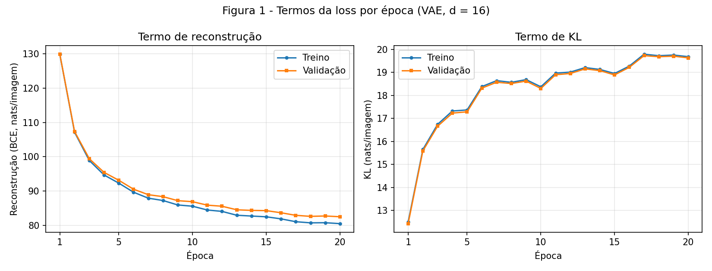
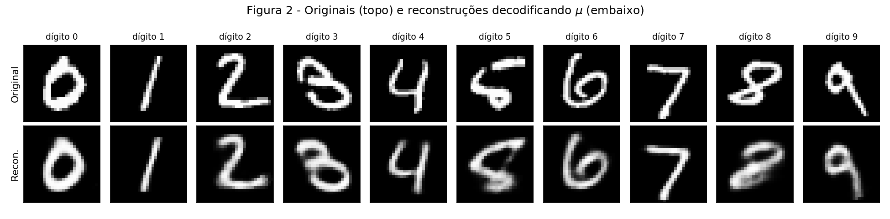
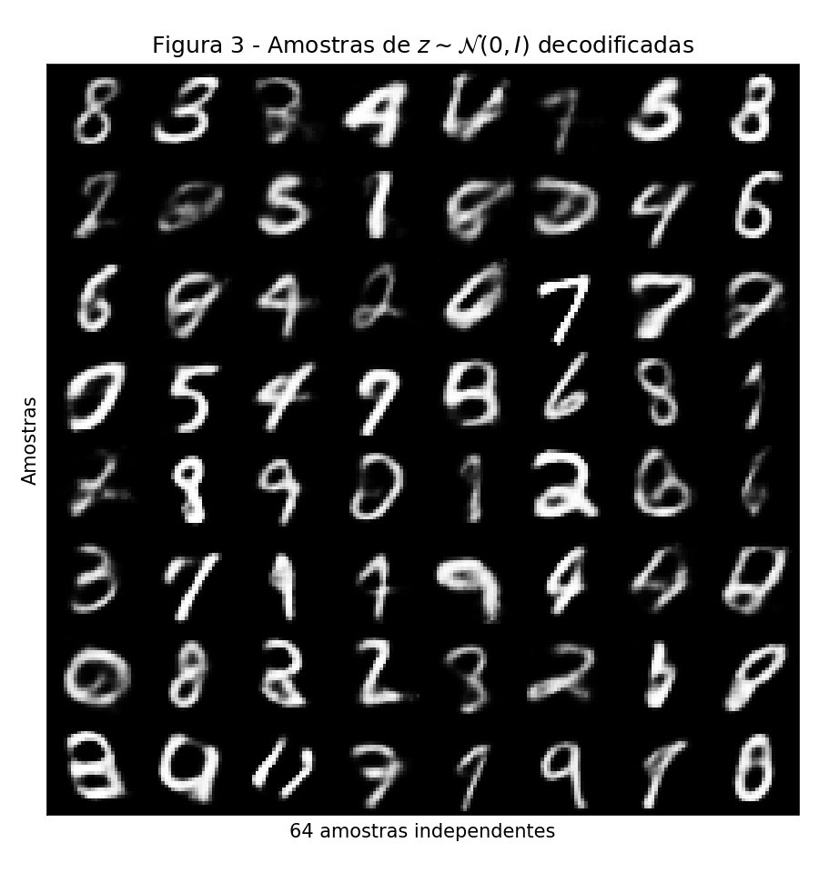
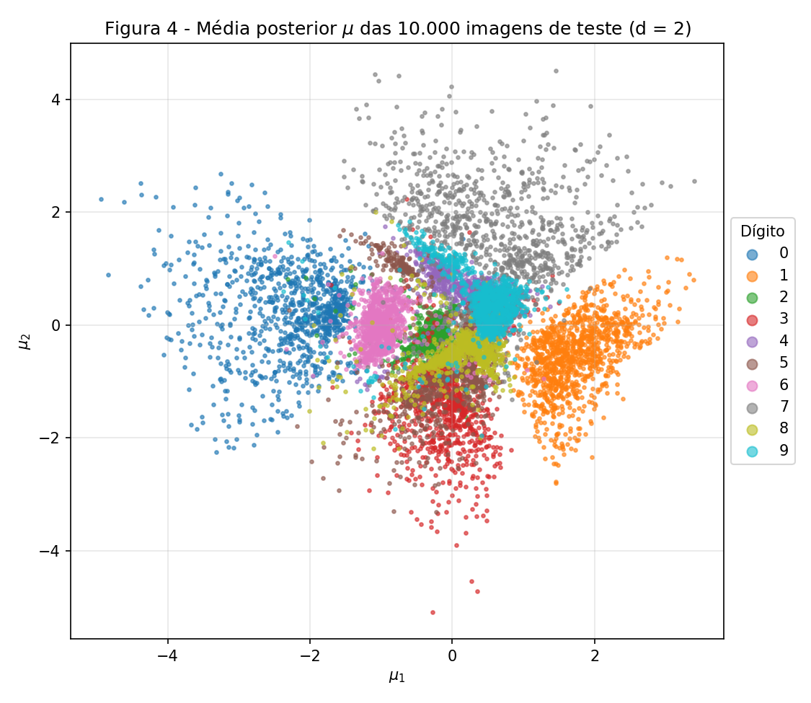
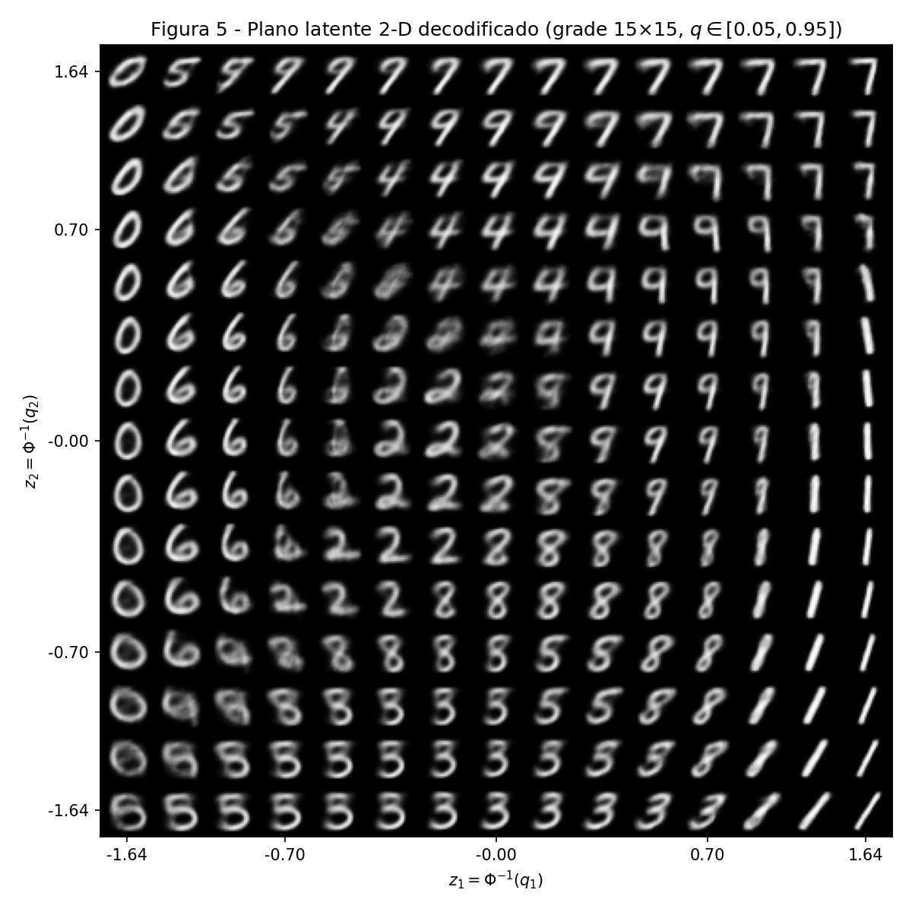
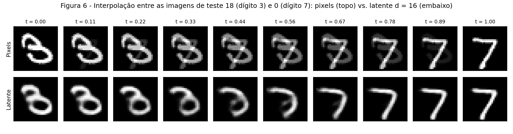

exercise: vae
ai_use: "Claude foi usado para implementar o VAE em PyTorch e os scripts dos experimentos a partir do enunciado, e para redigir a primeira versão das análises. Todos os números e figuras do relatório vêm da execução dos scripts do repositório, e as análises foram escritas olhando as figuras geradas."
---

# 4. VAE

!!! abstract "Enunciado"

    [Exercises → VAE](https://insper.github.io/ann-dl/2026.2/exercises/vae/){:target='_blank'}

**Reprodutibilidade.** Todos os números abaixo vêm de uma execução em CPU (PyTorch 2.14, `torch.manual_seed(42)` antes de construir cada
modelo e `Generator().manual_seed(42)` no split). Os valores são determinísticos nessa configuração, mas outra máquina ou outra versão do
PyTorch pode mudar as últimas casas decimais. Dependências: `torch`, `torchvision`, `numpy`, `matplotlib`, `scipy`, `scikit-learn`.
O MNIST é baixado pelo `torchvision` para `~/.cache/ann-dl-mnist` (fora do repositório; dá para trocar com a variável `MNIST_DIR`).

## Exercise 1

### A — Dados

MNIST do `torchvision`, pixels em $[0,1]$ e imagens achatadas em vetores de 784 posições (dividir os bytes por 255 equivale ao `ToTensor()`).
Os 60.000 exemplos de treino foram divididos com `random_split` e `torch.Generator().manual_seed(42)` em **50.000 para treino e 10.000 para
validação**; as 10.000 imagens oficiais de teste formam o conjunto de teste. O conjunto de teste só é usado nos números finais, e nenhuma decisão de
treino o usa (não há *early stopping* nem seleção de modelo: são sempre 20 épocas e o modelo da última época é o avaliado).

### B — Modelo e loss

Encoder $784\to512\to256$ (ReLU), duas cabeças lineares $256\to d$ para $\mu$ e $\log\sigma^2$, decoder $d\to256\to512\to784$ (ReLU nas ocultas e
sigmoide na saída), com $d=16$. A loss por imagem, com $\beta=1$, é

$$
\mathcal L = \underbrace{-\sum_{j=1}^{784}\big[x_j\log\hat x_j+(1-x_j)\log(1-\hat x_j)\big]}_{\text{BCE}}
\;+\;\beta\,\underbrace{\tfrac12\sum_{i=1}^{d}\big(\mu_i^2+\sigma_i^2-1-\log\sigma_i^2\big)}_{\text{KL}}
$$

- **BCE.** É o negativo do log da verossimilhança de Bernoulli, $-\log p(x\mid z)$, o que combina com o MNIST (pixels quase binários, e a saída $\hat x_j$ é
  uma probabilidade). Usei `F.binary_cross_entropy(..., reduction="sum")` e dividi pelo tamanho do batch; com `reduction="mean"` o termo de
  reconstrução ficaria dividido por 784 e o $\beta$ efetivo seria ≈ 784.
- **KL em forma fechada.** Para uma dimensão, com $q=\mathcal N(\mu,\sigma^2)$ e $p=\mathcal N(0,1)$:
  $\mathrm{KL}=\mathbb E_q[\log q-\log p]=-\tfrac12\log\sigma^2-\tfrac12\frac{\mathbb E_q[(z-\mu)^2]}{\sigma^2}+\tfrac12\mathbb E_q[z^2]$, e como
  $\mathbb E_q[(z-\mu)^2]=\sigma^2$ e $\mathbb E_q[z^2]=\sigma^2+\mu^2$, resulta em $\tfrac12(\mu^2+\sigma^2-1-\log\sigma^2)$. As $d$ dimensões são
  independentes, então os KLs se somam. No código, $\sigma^2=\exp(\text{logvar})$.
- **Reparametrização.** $z=\mu+\sigma\odot\varepsilon$ com $\varepsilon\sim\mathcal N(0,I)$: o ruído é a única parte aleatória, então o gradiente passa
  por $\mu$ e $\sigma$.

``` { .python .copy .select linenums='1' title="docs/exercises/vae/code/vae.py" }
--8<-- "docs/exercises/vae/code/vae.py"
```

1. `reparameterize` e `loss_terms` são escritos à mão. Só o autograd é usado (para os gradientes).
2. `loss_terms` devolve os dois termos **somados no batch**: dividir por $N$ fora garante a unidade nats por imagem.

### C — Treino

Adam, $\eta=10^{-3}$, batch 128, 20 épocas, $\beta=1$. Ao fim de cada época, reconstrução e KL são medidos **separadamente** no treino completo e na
validação (nats por imagem; a reconstrução usa uma amostra de $z$ por imagem, com gerador fixo).

``` { .python .copy .select linenums='1' title="docs/exercises/vae/code/exercise1_vae.py" }
--8<-- "docs/exercises/vae/code/exercise1_vae.py"
```


/// caption
**Figura 1** — Reconstrução (esquerda) e KL (direita) por época, no treino e na validação.
///

| Época | Treino: reconstrução | Treino: KL | Validação: reconstrução | Validação: KL |
|---|---|---|---|---|
| 1 | 129.86 | 12.50 | 129.93 | 12.43 |
| 5 | 92.29 | 17.37 | 93.12 | 17.29 |
| 10 | 85.56 | 18.37 | 86.87 | 18.30 |
| 20 | 80.47 | 19.68 | 82.48 | 19.63 |

**Resultado no conjunto de teste (modelo da época 20, $d=16$):**
reconstrução = **81.88 nats**, KL = **19.65 nats**, e portanto $-\text{ELBO}$ = 81.88 + 19.65 = **101.53 nats por imagem** (o enunciado esperava ≈ 81 e ≈ 20).
Treino e validação ficam próximos (a diferença de reconstrução na época 20 é de ≈ 2 nats), então o modelo quase não sobreajusta em 20 épocas.

### D — Reconstruções e amostras


/// caption
**Figura 2** — Primeira imagem de teste de cada dígito (topo) e sua reconstrução decodificando $\mu$ (embaixo).
///


/// caption
**Figura 3** — Grade 8×8 de imagens decodificadas de $z\sim\mathcal N(0,I)$ (`torch.manual_seed(0)`).
///

### E — Análise

**1. Por que o otimizador aceita mais KL se a loss total cai?** O que se minimiza é a **soma** dos dois termos, não cada um separadamente. O KL mede
quanta informação sobre a imagem o encoder coloca em $z$ (em nats), e é o "preço" dessa informação. No começo o código carrega pouca informação, e o
decoder, sem saber qual dígito é, só consegue reconstruir uma imagem média. Cada nat extra de KL que o encoder "gasta" permite ao decoder cortar **mais
de um nat** de reconstrução, então a soma diminui. Nos números: na validação, o KL sobe de 12.43 (época 1) para 19.63 (época 20; máximo de 19.73 na época 17)
enquanto a reconstrução cai de 129.93 para 82.48, e a $-\text{ELBO}$ de validação cai de 142.36 para 102.11. O KL só sobe enquanto cada nat adicional
compra mais que um nat de reconstrução; nas épocas finais o ganho de reconstrução diminui e o KL se estabiliza em torno de 19–20 nats, que é o ponto onde
os dois termos se equilibram. Um detalhe: das 16 dimensões latentes, **11 estão ativas** e 5 ficaram com KL ≈ 0 no teste (≤ 0.002 nat, as dimensões de
índice 4, 7, 9, 12 e 15, contando de 0), ou seja, o modelo "desligou" essas dimensões, porque não compensa pagar KL por elas.

**2. Por que a Figura 3 parece pior que a Figura 2?** (*Observação:* a Figura 2 também não é perfeita: as reconstruções do 3, do 5 e do 8 saem
borradas ou trocadas, o 3 vira algo parecido com um 8 e o 8 vira uma mancha. Mesmo assim os traços de Fig. 2 são mais nítidos que os da Fig. 3.) Duas razões
distintas:

- *Onde as amostras do prior caem no espaço latente.* O decoder só foi treinado em pontos $z$ vindos do encoder, ou seja, da distribuição agregada
  $q(z)=\frac1N\sum_x q(z\mid x)$. O KL aproxima cada $q(z\mid x)$ do prior só **em média**, então $q(z)$ não preenche o prior por inteiro: os dígitos
  formam regiões, e é plausível que entre elas fiquem zonas onde o prior tem massa, mas o decoder viu poucos dados (a Figura 4, no caso $d=2$,
  mostra a distribuição agregada organizada em aglomerados por dígito, com zonas de transição entre eles). Uma amostra $z\sim\mathcal N(0,I)$ que cai num buraco ou numa fronteira entre classes decodifica
  para algo ambíguo ou híbrido (várias amostras da Figura 3 não são dígitos reconhecíveis). Na Figura 2, ao contrário, o $z$ vem do encoder e cai
  numa região bem treinada.
- *O que o decoder devolve para um dado $z$.* O decoder produz as **probabilidades** $\hat x_j=p(x_j=1\mid z)$ de cada pixel (saída sigmoide com
  verossimilhança de Bernoulli), isto é, a **média** condicional $\mathbb E[x\mid z]$, e não uma imagem sorteada. Um $z$ de 16 números (e com o KL
  limitando a informação) não fixa detalhes como a espessura exata ou a posição fina do traço, então o decoder responde com a média das imagens
  compatíveis com aquele $z$, que é uma imagem de traços suaves e borrados. Na Figura 2 o $z$ é informativo sobre aquela imagem específica, então a média
  fica próxima do original; na Figura 3, $z$ não tem uma imagem de origem, e o que sai é só a média borrada.

**3. Por que decodificar $\mu$ e não um $z$ amostrado na Figura 2?** A Figura 2 quer mostrar *quanto da imagem o código preserva*. $\mu$ é a média
da posterior, o ponto central e determinístico da crença do encoder. Decodificar um $z=\mu+\sigma\varepsilon$ misturaria a qualidade da reconstrução com
o ruído de amostragem: a mesma imagem produziria reconstruções diferentes a cada execução, com parte do erro vindo do sorteio e não do modelo. Com $\mu$,
a figura é reprodutível e mostra a melhor estimativa do encoder.

## Exercise 2

### A — Modelo com $d=2$

Mesma arquitetura, dados, semente (`torch.manual_seed(42)` antes de construir o modelo), $\beta=1$ e orçamento (Adam, $10^{-3}$, batch 128, 20 épocas) do
Exercício 1, mudando só $d=2$ (o decoder passa a começar em $2\to256$).

``` { .python .copy .select linenums='1' title="docs/exercises/vae/code/exercise2_vae.py" }
--8<-- "docs/exercises/vae/code/exercise2_vae.py"
```

| Modelo | Reconstrução (nats) | KL (nats) | $-\text{ELBO}$ (nats) |
|---|---|---|---|
| $d=16$ (Exercício 1) | 81.88 | 19.65 | 101.53 |
| $d=2$ | **135.54** | **6.57** | 142.11 |

O enunciado esperava ≈ 135 e ≈ 7 para $d=2$. Com $d=2$ a reconstrução piora em 53.7 nats e o KL cai 13.1 nats: o modelo carrega só 6.57 nats
(≈ 9.5 bits) de informação por imagem, em duas dimensões ativas (KL de 3.37 e 3.20 nats).

### B — Teste codificado


/// caption
**Figura 4** — $\mu$ das 10.000 imagens de teste no modelo $d=2$, colorido pelo dígito.
///

### C — Plano decodificado


/// caption
**Figura 5** — Grade 15×15 de imagens decodificadas em $z=\Phi^{-1}(q)$, com $q$ em 15 valores igualmente espaçados em $[0.05,0.95]$
($z_1$ cresce da esquerda para a direita, $z_2$ de baixo para cima).
///

**Por que essa grade dá a mesma massa do prior a cada célula:** como $q$ é igualmente espaçado e $\Phi$ é a CDF da $\mathcal N(0,1)$, dois pontos vizinhos
da grade em qualquer eixo delimitam sempre a mesma probabilidade, $\Phi(z_{i+1})-\Phi(z_i)=0.9/14$, e como as duas coordenadas são independentes
sob o prior, toda célula tem a mesma massa (uma grade linear em $z$ gastaria a maior parte das células nas caudas, onde o prior quase não tem massa).

### D — Interpolação

Escolhi, por uma regra fixada antes de ver o resultado, a **primeira imagem de teste dos dígitos 3 e 7**: índices **18** (dígito 3) e **0** (dígito 7).
A linha de cima é a mistura em pixels, $(1-t)x_a+t\,x_b$; a de baixo, a mistura no espaço latente do **modelo $d=16$** do Exercício 1,
$\text{decode}\big((1-t)\mu_a+t\,\mu_b\big)$, com 10 valores de $t$ de 0 a 1.


/// caption
**Figura 6** — Interpolação entre as imagens de teste 18 (dígito 3) e 0 (dígito 7): pixels (topo) e latente $d=16$ (embaixo).
///

### E — Análise

**1. Quais dígitos se sobrepõem na Figura 4, e a mesma transição na Figura 5.** Na Figura 4, os dígitos 0 (à esquerda), 1 (à direita), 7 (em cima) e 3 (embaixo)
ocupam regiões bem separadas, enquanto 2, 4, 5, 8 e 9 se amontoam no centro. Para quantificar, ajustei um kNN (k = 15) sobre os $\mu$ 2-D do treino e o avaliei
no teste: acerta só 79.4%, e os pares mais confundidos (erros nos dois sentidos) são **4 e 9 (596 erros)**, **3 e 5 (328)**, 7 e 9 (163), 5 e 8 (159) e
3 e 8 (156); o recall do 5 é 52.2%, o do 4 é 61.6% e o do 9 é 61.8%, contra 96.6% do 0 e 97.9% do 1. Na Figura 5, a transição **4 ↔ 9** aparece na região
superior central: indo da esquerda para a direita nas linhas de $z_2\approx0.5$ a $1.2$, vem uma sequência de 4 e depois de 9, e as células de
transição são híbridos, com o topo parcialmente aberto, entre um 4 e um 9 (traços mais fracos e borrados). A fronteira **3 ↔ 5** aparece na parte de baixo, com 5
e 3 alternados e imagens ambíguas entre eles, e há uma zona de transição 6/2/4 no centro, de traços sobrepostos e quase ilegíveis. Nenhuma fronteira é abrupta: as
classes se misturam continuamente, o que casa com a sobreposição vista na Figura 4.

**2. O que dois números por imagem obrigam o modelo a descartar.** Com $d=2$ a reconstrução é 135.54 nats, contra 81.88 com $d=16$ (+53.7 nats). Dois números
precisam codificar *qual dígito* e todo o resto, então o modelo guarda a identidade grosseira do dígito e uma pequena variação de estilo (inclinação,
largura geral) e **descarta os detalhes do traço**: a espessura, a forma exata das curvas, os laços e as pequenas variações de caligrafia. A Figura 5 mostra
isso: dentro de cada região, todas as células mostram um **protótipo** do dígito (os 0 são todos iguais, os 1 são linhas finas que só variam de inclinação ao
longo da borda direita), e as imagens são mais borradas que as reconstruções com $d=16$. Esse protótipo é o que sobra quando só há duas coordenadas: todas as
imagens de um mesmo dígito com pequenas diferenças de estilo são mapeadas para o mesmo ponto.

**3. Comparação das duas linhas da Figura 6.** A linha de **pixels** é uma *superposição*: em $t=0.5$ aparece o 3 e o 7 ao mesmo tempo, cada um com metade da
intensidade, e nenhum quadro intermediário parece um dígito. A linha **latente** faz uma transição contínua: o traço do 3 vai se transformando na curva de cima
do 7 (passando por formas curvas e uma haste), e os quadros a partir de $t\approx0.55$ já parecem 7 de verdade. Os quadros do meio ($t\approx0.33$–$0.44$) são
formas curvas borradas, que lembram pouco um dígito, então a interpolação latente também não é perfeita. A razão da diferença: as imagens que parecem dígitos
ocupam uma superfície fina e curva dentro do espaço de 784 pixels, e a reta entre duas imagens no espaço de pixels sai dessa superfície (mistura de dois dígitos
não é um dígito). No espaço latente, o decoder aprendeu a mapear as vizinhanças dos códigos (e o KL aproxima os códigos do prior e os faz se sobreporem), então a reta
entre dois $\mu$ passa por códigos que o decoder mapeia para imagens plausíveis. Uma ressalva: no quadro $t=0$ da linha latente o 3 não aparece como o original, porque
é a *reconstrução* do modelo $d=16$ para essa imagem, que parece um 8 (é a mesma imagem 3 que a Figura 2 mostra reconstruída como um 8).

## Discussão

Quatro pontos de transparência. **(1)** A reconstrução de teste usa uma única amostra de $z$ por imagem (estimador de Monte Carlo); com 10.000 imagens o ruído é
pequeno, mas não nulo, e o KL é calculado em forma fechada e portanto exato. **(2)** Nada foi ajustado olhando o teste: arquitetura, $\eta$, batch, épocas e $\beta$
são os do enunciado. **(3)** As afirmações sobre "buracos" no espaço latente do modelo $d=16$ (item 1E.2) são uma interpretação apoiada na Figura 4 do modelo
$d=2$ e no aspecto das amostras da Figura 3, e não uma medição direta da densidade agregada em 16 dimensões. **(4)** O par de imagens da interpolação foi
escolhido por uma regra simples (primeira imagem de cada dígito), não por ser o mais bonito: a linha latente tem quadros intermediários borrados, e isso
está no texto.

## Results summary

| # | Quantidade | Valor |
|---|---|---|
| 1 | Ex. 1: reconstrução, KL e $-\text{ELBO}$ de teste ($d=16$) | 81.88 nats; 19.65 nats; 101.53 nats |
| 2 | Ex. 1: KL de validação na primeira e na última época | 12.43 (época 1); 19.63 (época 20) |
| 3 | Ex. 2: reconstrução e KL de teste ($d=2$) | 135.54 nats; 6.57 nats |
| 4 | Ex. 2: os dois índices de teste interpolados | 18 (dígito 3) e 0 (dígito 7) |
