# EDA — preços de anúncios do Airbnb em Nova York

!!! abstract "Enunciado"

    [Projects → EDA](https://insper.github.io/ann-dl/2026.2/projects/eda/){:target='_blank'}

**Tarefa:** regressão. **Alvo:** `price`, a diária do anúncio em dólares. Nenhum modelo é treinado neste entregável.

**Reprodutibilidade.** Todos os números vêm de uma execução em Python 3.11 com `pandas 3.0.2`, `numpy 2.4.4`, `scipy 1.17.1`,
`scikit-learn 1.8.0`, `matplotlib 3.10.9` e `umap-learn 0.5.12`, com `random_state=42` em todo lugar onde há sorteio. O arquivo de dados
está no repositório (`data/AB_NYC_2019.csv`), então tudo roda de um clone limpo:

```bash
pip install -r requirements.txt
cd docs/projects/eda/code
python stage1_inspection.py && python stage2_univariate.py && python stage3_bivariate.py && python stage4_preprocessing.py
```

Os scripts gravam as figuras em `figures/` e imprimem as tabelas que aparecem abaixo. Outra versão das bibliotecas pode mudar as últimas casas
decimais, principalmente no t-SNE e no UMAP. Todo o código compartilhado (caminhos, lista de colunas, split e estilo dos gráficos) está em
`common.py`, de modo que o split e as listas de colunas são exatamente os mesmos em todas as etapas.

??? note "common.py"

    ``` { .python .copy .select linenums='1' title="docs/projects/eda/code/common.py" }
    --8<-- "docs/projects/eda/code/common.py"
    ```

---

## 1. Inspeção inicial

### A. Dicionário de dados

**Fonte.** `AB_NYC_2019.csv`, o arquivo do conjunto *New York City Airbnb Open Data* do Kaggle, que descreve anúncios de Airbnb em Nova York
com datas de avaliação até 08/07/2019. O arquivo no repositório é uma cópia obtida de um espelho público no GitHub; conferi a forma
(48.895 × 16), as contagens de valores ausentes e as estatísticas de `price` com os valores conhecidos do arquivo original. A licença do conjunto, conforme a página do Kaggle, é CC0 1.0 (domínio público), que permite copiar e redistribuir o arquivo.

**O que é uma linha.** Um anúncio (*listing*) de hospedagem em Nova York em um instante de 2019. Há 48.895 linhas e nenhum `id` repetido.

| coluna | significado | tipo | unidade / valores | papel |
|---|---|---|---|---|
| `id` | identificador do anúncio | inteiro | — | descartada (identificador) |
| `name` | título do anúncio | texto livre | — | descartada (texto livre) |
| `host_id` | identificador do anfitrião | inteiro | — | descartada (identificador) |
| `host_name` | nome do anfitrião | texto livre | — | descartada (texto livre) |
| `neighbourhood_group` | distrito (*borough*) | categórica nominal | 5 níveis | feature |
| `neighbourhood` | bairro | categórica nominal | 221 níveis no arquivo (220 no treino) | feature |
| `latitude` | latitude do anúncio | numérica contínua | graus | feature |
| `longitude` | longitude do anúncio | numérica contínua | graus | feature |
| `room_type` | tipo de acomodação | categórica nominal | 3 níveis | feature |
| `price` | **diária do anúncio** | numérica inteira | dólares por noite | **alvo** |
| `minimum_nights` | mínimo de noites por reserva | numérica discreta | noites | feature |
| `number_of_reviews` | total de avaliações recebidas | numérica discreta | contagem | feature |
| `last_review` | data da última avaliação | data (texto) | AAAA-MM-DD | descartada (ver 1B) |
| `reviews_per_month` | avaliações por mês | numérica contínua | avaliações/mês | feature |
| `calculated_host_listings_count` | nº de anúncios do mesmo anfitrião no arquivo | numérica discreta | contagem | feature |
| `availability_365` | dias do ano em que o anúncio está disponível para reserva | numérica discreta | dias (0 a 365) | feature |

São 7 features numéricas e 3 categóricas (10 no total), mais o alvo. As colunas descartadas e os motivos estão em 1B.

### B. Qualidade

As contagens abaixo são regras que não aprendem nada dos dados (contar ausentes, achar valores impossíveis), então foram feitas no arquivo
bruto, antes do split (1D). Nenhuma estatística de decisão vem daqui.

**Valores ausentes** (as outras 12 colunas não têm nenhum):

| coluna | ausentes | % |
|---|---|---|
| `reviews_per_month` | 10.052 | 20,56 |
| `last_review` | 10.052 | 20,56 |
| `host_name` | 21 | 0,04 |
| `name` | 16 | 0,03 |

**A ausência de `reviews_per_month` e `last_review` é estrutural, não aleatória.** Os 10.052 anúncios com `number_of_reviews == 0` são
exatamente os que têm `reviews_per_month` ausente e exatamente os que têm `last_review` ausente (interseção de 10.052 nos dois casos, e
nenhum anúncio com zero avaliações tem `reviews_per_month` preenchido). Ou seja, "ausente" aqui significa "ainda sem avaliações", e o
valor correto da taxa é 0, não uma média ou mediana.

**Duplicatas:** 0 linhas duplicadas (com e sem a coluna `id`) e 0 ids repetidos.

**Valores impossíveis ou inconsistentes:**

| verificação | linhas |
|---|---|
| `price <= 0` | **11** (preço impossível para uma diária) |
| `minimum_nights > 365` (mais de um ano) | 14 (máximo = 1.250 noites) |
| latitude fora de [40,4; 41,0] ou longitude fora de [-74,3; -73,7] | 0 |
| `availability_365` fora de [0, 365] | 0 |
| `number_of_reviews < 0` | 0 |
| `availability_365 == 0` (válido, mas atípico) | 17.533 (35,9%) |

As 11 linhas com `price <= 0` são removidas por regra (um preço de zero não é uma diária). Os 14 `minimum_nights` acima de 365 são improváveis,
mas não impossíveis, e ficam para o tratamento de outliers (4A). Os 17.533 anúncios com `availability_365 == 0` são válidos (provavelmente
anúncios inativos ou bloqueados), mas não dá para distingui-los dos outros só com este arquivo, então são mantidos.

**Colunas a descartar e vazamento do alvo:**

- `id` e `host_id`: identificadores (48.895 e 37.457 valores únicos). Não carregam significado e, como identificadores, um modelo poderia
  só memorizá-los.
- `name` e `host_name`: texto livre (47.905 e 11.452 valores únicos). Aproveitá-lo exigiria processamento de linguagem natural, fora do
  escopo desta EDA.
- `last_review`: data redundante com `number_of_reviews` (ausente exatamente quando não há avaliações) e relativa a uma data de coleta que o
  arquivo não informa. Descartada.
- Nenhuma coluna é constante.
- **Vazamento do alvo.** Investiguei se alguma feature é derivada do preço ou quase uma função dele. Nenhuma tem cara de ser (todas
  descrevem o anúncio, a localização ou a atividade de avaliações), e a maior correlação de Spearman com `price` entre as numéricas é
  |ρ| = 0,440 (`longitude`), longe de 1. Não há vazamento direto.

### C. Alvo

Todas as estatísticas do alvo usam só o **treino** (o split vem em 1D e foi feito antes desta análise).

| estatística de `price` (USD) | treino |
|---|---|
| n | 39.107 |
| média | 152,28 |
| mediana | 106 |
| desvio-padrão | 233,69 |
| mínimo | 10 |
| Q1 / Q3 | 69 / 175 |
| P95 / P99 / P99,5 | 350 / 795 / 1.000 |
| máximo | 10.000 |
| assimetria / curtose | **18,82** / 578,5 |

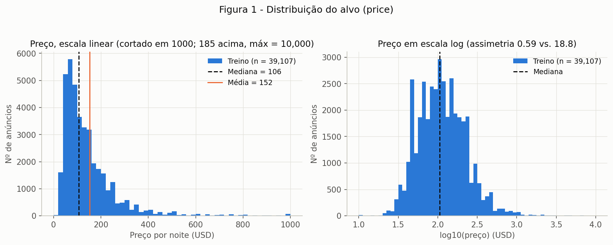

**Figura 1.** À esquerda, o preço em escala linear (cortado no P99,5 = 1.000 para a massa principal ser visível, com 185 anúncios acima e
máximo de 10.000); à direita, em escala log10.

**Conclusão.** O preço tem cauda direita muito pesada: a média (152) é 1,44 vez a mediana (106), a assimetria é 18,82 e a curtose 578,5.
Há 236 anúncios com preço de 1.000 ou mais e 21 com 5.000 ou mais. Em escala logarítmica a distribuição fica quase simétrica: a
assimetria de ln(price) é **0,59** (e a de log1p é 0,61). Por isso o alvo do modelo será ln(price) (4A). Pela cerca de Tukey, 6,0% dos
anúncios seriam "outliers" na escala linear (acima de 334), mas apenas 1,28% (499 linhas) na escala log (fora de [17,1; 706,8]).

### D. Treino e teste

1. **Limpeza por regra:** removidas as 11 linhas com `price <= 0`, restando 48.884 anúncios.
2. **Split 80/20** com `train_test_split(..., random_state=42)`, **estratificado por decis do preço**. Como o alvo tem cauda pesada, a
   estratificação garante que treino e teste tenham a mesma distribuição de preços, inclusive nos extremos. Um split temporal não se aplica:
   a única data é `last_review`, ausente em 20,6% das linhas e sem relação com o preço do anúncio.
3. **Tamanhos:** treino 39.107 (80,0%) e teste 9.777 (20,0%).

| preço (USD) | treino | teste |
|---|---|---|
| média | 152,3 | 154,7 |
| Q1 | 69 | 69 |
| mediana | 106 | 106 |
| Q3 | 175 | 175 |
| P90 | 269 | 269 |
| P99 | 795 | 800 |

O teste de Kolmogorov–Smirnov entre os preços de treino e teste dá estatística 0,0046 (p = 0,996): não há diferença detectável. O treino
tem 220 bairros distintos e o teste 200; há 1 bairro que só aparece no teste (Fort Wadsworth, 1 linha), o que será tratado em 4A.
**A partir daqui, toda estatística aprendida (quantis, médias, desvios, categorias) vem apenas do treino.** Nas Etapas 2 e 3, as tabelas e
figuras usam só o treino.

??? note "stage1_inspection.py"

    ``` { .python .copy .select linenums='1' title="docs/projects/eda/code/stage1_inspection.py" }
    --8<-- "docs/projects/eda/code/stage1_inspection.py"
    ```

---

## 2. Análise univariada

### A. Variáveis numéricas

| feature | n | média | mediana | desvio | mín | Q1 | Q3 | máx | assimetria | ausentes | zeros |
|---|---|---|---|---|---|---|---|---|---|---|---|
| `latitude` | 39.107 | 40,73 | 40,72 | 0,05 | 40,50 | 40,69 | 40,76 | 40,91 | 0,24 | 0 | 0 |
| `longitude` | 39.107 | -73,95 | -73,96 | 0,05 | -74,24 | -73,98 | -73,94 | -73,71 | 1,29 | 0 | 0 |
| `minimum_nights` | 39.107 | 7,08 | 2 | 20,74 | 1 | 1 | 5 | 1.250 | 21,82 | 0 | 0 |
| `number_of_reviews` | 39.107 | 23,30 | 5 | 44,53 | 0 | 1 | 24 | 629 | 3,66 | 0 | 8.056 |
| `reviews_per_month` | 31.051 | 1,37 | 0,71 | 1,69 | 0,01 | 0,19 | 2,00 | 58,50 | 3,35 | 8.056 | 0 |
| `calculated_host_listings_count` | 39.107 | 7,24 | 1 | 33,30 | 1 | 1 | 2 | 327 | 7,85 | 0 | 0 |
| `availability_365` | 39.107 | 112,73 | 45 | 131,78 | 0 | 0 | 227 | 365 | 0,77 | 0 | 14.088 |

As amplitudes diferem em quase quatro ordens de grandeza: `latitude` varia 0,41 e `minimum_nights` varia 1.249. Isso motiva a padronização (4A).

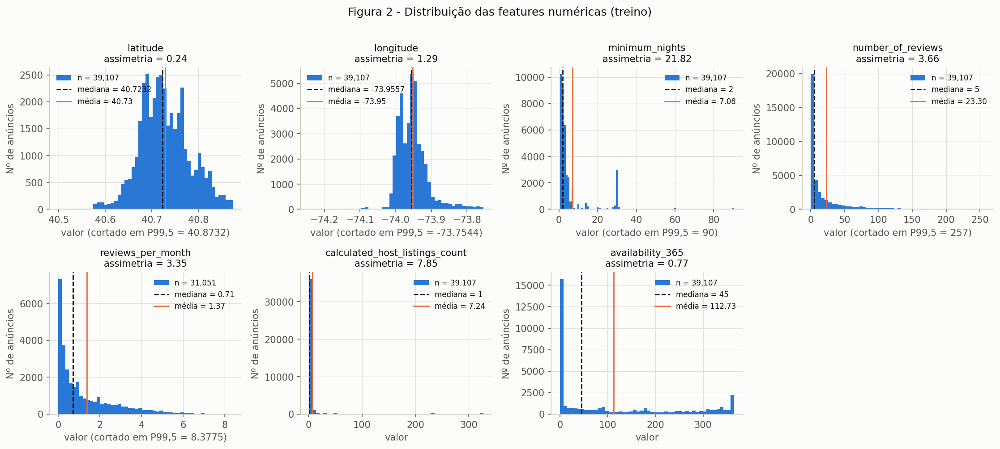

**Figura 2.** Histograma de cada feature numérica (cortado no P99,5 quando há cauda), com mediana (tracejada) e média (laranja).

**Conclusão.** Há três famílias de formato. (i) `latitude` e `longitude` têm forma de sino com várias corcovas, que correspondem aos
distritos, e assimetria baixa (0,24 e 1,29, esta com uma cauda para o leste). (ii) `minimum_nights`, `number_of_reviews`,
`reviews_per_month` e `calculated_host_listings_count` têm cauda direita muito pesada, com média muito acima da mediana (por exemplo, 7,08
contra 2 noites). (iii) `availability_365` é quase bimodal: 36,0% dos anúncios têm 0 dia disponível, 2,7% têm 365, e os 61,3% restantes se
espalham entre esses extremos. Os modos de `minimum_nights` são 1 noite (26,2%), 2 (23,9%) e 30 (7,7%), e 1,6% passam de 30. O número de
avaliações é 0 em 20,6% dos anúncios, e 66,1% dos anúncios são de anfitriões com um único anúncio (1.122 linhas pertencem a anfitriões com 50 ou mais anúncios).

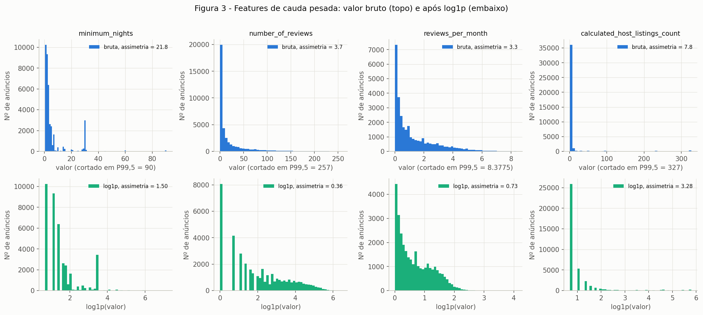

**Figura 3.** As quatro features de cauda pesada antes (em cima) e depois (embaixo) de `log1p`.

| feature | assimetria bruta | assimetria após `log1p` | P99,5 | linhas acima do P99,5 |
|---|---|---|---|---|
| `minimum_nights` | 21,82 | 1,50 | 90 | 162 |
| `number_of_reviews` | 3,66 | 0,36 | 257 | 192 |
| `reviews_per_month` | 3,35 | 0,73 | 8,38 | 156 |
| `calculated_host_listings_count` | 7,85 | 3,28 | 327 | 0 |

**Conclusão.** `log1p` funciona bem em `number_of_reviews` (3,66 → 0,36) e `reviews_per_month` (3,35 → 0,73), e melhora muito
`minimum_nights` (21,82 → 1,50, o que sobra são os picos discretos em 1, 2 e 30). Em `calculated_host_listings_count` ajuda menos
(7,85 → 3,28), porque o pico em 1 e um pequeno grupo de grandes anfitriões (até 327 anúncios) continuam presentes. O P99,5 dessa coluna
é igual ao máximo, então um corte nesse quantil não altera nenhuma linha dela. `availability_365` não é candidata a log: tem 36% de zeros
e assimetria só 0,77. O valor mais extremo é `reviews_per_month = 58,5` (quase duas avaliações por dia), e há 1.189 linhas acima de 5.

### B. Variáveis categóricas

| feature | categorias (treino) | mais frequente | % da moda | menor contagem | ausentes |
|---|---|---|---|---|---|
| `neighbourhood_group` | 5 | Manhattan | 44,4 | 295 | 0 |
| `neighbourhood` | **220** | Williamsburg | 8,0 | 1 | 0 |
| `room_type` | 3 | Entire home/apt | 51,9 | 938 | 0 |

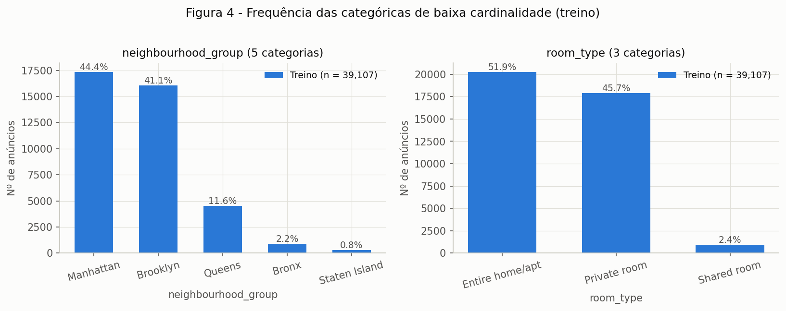

**Figura 4.** Frequência de `neighbourhood_group` (5 níveis) e `room_type` (3 níveis) no treino.

**Conclusão.** Manhattan (44,4%) e Brooklyn (41,1%) concentram 85,5% dos anúncios, enquanto **Staten Island tem só 295 anúncios (0,8%)** e o
Bronx 871 (2,2%). Em `room_type`, `Entire home/apt` (51,9%) e `Private room` (45,7%) dominam, e **`Shared room` é raro: 938 anúncios (2,4%)**.
São as categorias raras de baixa cardinalidade, e qualquer análise por grupo precisa lembrar que suas estimativas são menos estáveis.

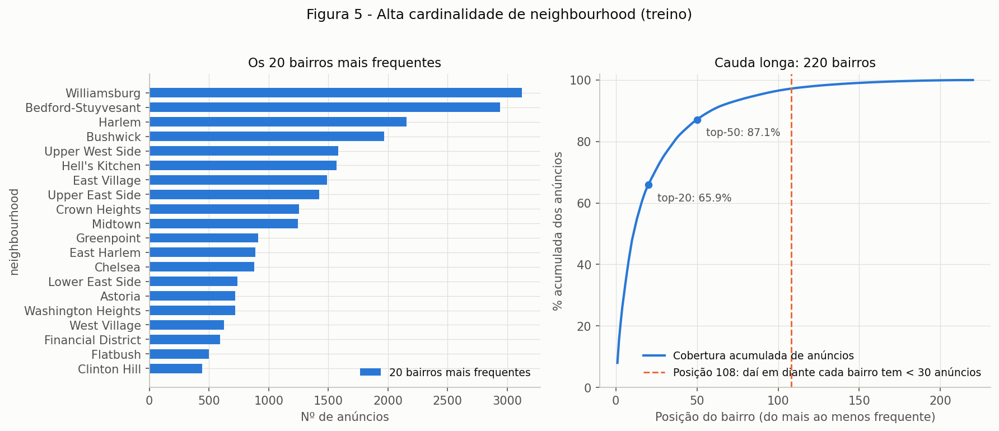

**Figura 5.** À esquerda, os 20 bairros mais frequentes; à direita, a cobertura acumulada de anúncios pelos 220 bairros em ordem de frequência.

| subconjunto de bairros | cobertura dos anúncios |
|---|---|
| top-10 | 47,9% |
| top-20 | 65,9% |
| top-50 | 87,1% |
| top-100 | 96,5% |

**Conclusão.** `neighbourhood` tem cardinalidade alta e cauda longa: **112 dos 220 bairros (51%) têm menos de 30 anúncios** e juntos cobrem só
1.089 linhas (2,8%); 9 bairros aparecem uma única vez no treino. Os 108 bairros com 30 ou mais anúncios cobrem 97,2% dos dados. Codificar
os 220 níveis separadamente criaria muitas colunas quase vazias e estimativas ruins para os raros, o que motiva o agrupamento de
categorias raras em 4A.

??? note "stage2_univariate.py"

    ``` { .python .copy .select linenums='1' title="docs/projects/eda/code/stage2_univariate.py" }
    --8<-- "docs/projects/eda/code/stage2_univariate.py"
    ```

---

## 3. Análise bivariada e multivariada

Nas figuras desta etapa o alvo aparece como ln(price), a escala em que a relação é mais legível (assimetria 0,59). Todo o cálculo usa só o treino.

### A. Numérica × numérica

**Método: Spearman.** Escolhi a correlação de Spearman, e não a de Pearson, porque as features são muito assimétricas, têm picos discretos e
outliers, e o que interessa é a relação monotônica. Pearson é sensível à cauda: por exemplo, `longitude` × preço bruto dá −0,154 por Pearson,
−0,328 por Pearson com ln(price) e −0,440 por Spearman, três valores diferentes para a mesma relação.

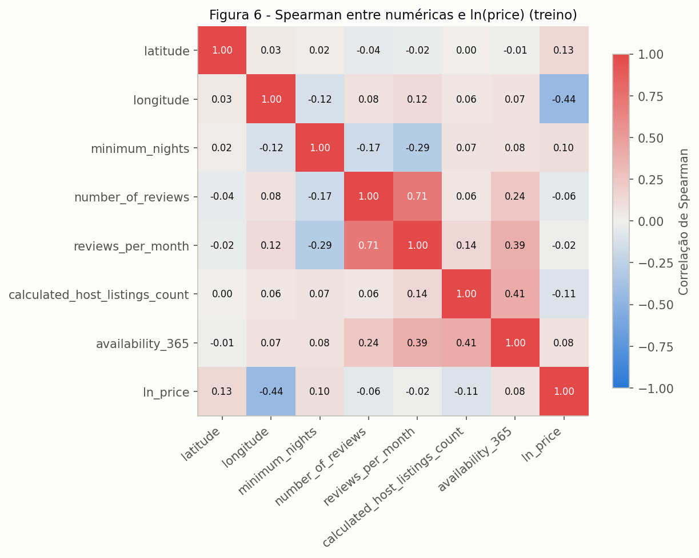

**Figura 6.** Matriz de correlação de Spearman entre as 7 features numéricas e ln(price).

**Conclusão.** O par mais correlacionado é **`number_of_reviews` × `reviews_per_month` (ρ = 0,71)**, esperado, porque a taxa mensal
parece ser construída a partir do total de avaliações. O segundo é `calculated_host_listings_count` × `availability_365` (0,41), seguido de
`reviews_per_month` × `availability_365` (0,39). Todos os outros pares têm |ρ| ≤ 0,29. O fator de inflação da variância (VIF), calculado
após `log1p`, imputação e padronização, é no máximo 2,57 (`reviews_per_month`), bem abaixo de 5, então não há colinearidade severa;
`latitude` quase não se correlaciona com nenhuma outra feature (|ρ| ≤ 0,04) e `longitude` só fracamente (|ρ| ≤ 0,12).

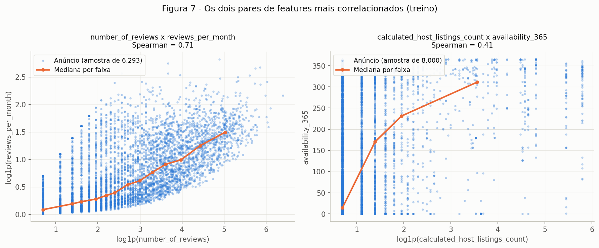

**Figura 7.** Dispersão dos dois pares mais correlacionados (amostra de 8.000 anúncios do treino), com a mediana por faixa em laranja.

**Conclusão.** O par `number_of_reviews` × `reviews_per_month` mostra uma relação crescente nítida e boa parte da informação de um é
redundante com o outro; manter os dois é aceitável para uma rede neural (o VIF é baixo), mas é o par a observar. No par
`calculated_host_listings_count` × `availability_365` a relação é só crescente em média: anfitriões com muitos anúncios (operações
profissionais) deixam os anúncios disponíveis por mais dias do ano, mas a dispersão vertical é enorme em qualquer nível.

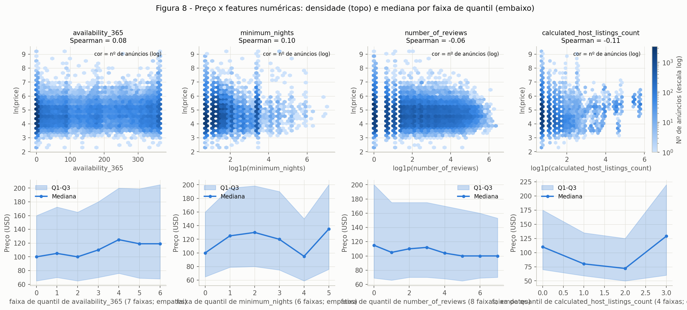

**Figura 8.** Quatro features numéricas contra ln(price): densidade (em cima) e mediana e Q1–Q3 do preço por faixa de quantil (embaixo).

| feature | Spearman com ln(price) | Pearson com ln(price) |
|---|---|---|
| `longitude` | −0,440 | −0,328 |
| `latitude` | 0,133 | 0,077 |
| `calculated_host_listings_count` | −0,109 | 0,135 |
| `minimum_nights` | 0,100 | 0,037 |
| `availability_365` | 0,081 | 0,095 |
| `number_of_reviews` | −0,056 | −0,043 |
| `reviews_per_month` | −0,022 | −0,040 |

**Conclusão.** Individualmente, as features numéricas explicam pouco do preço: só `longitude` passa de |ρ| = 0,13. As relações são em
geral **não monotônicas**. `calculated_host_listings_count` tem sinal negativo por Spearman (−0,109) e positivo por Pearson (+0,135), e a
mediana do preço por faixa de quantil vai de 110 (1 a 2 anúncios) para 80 e 72 e sobe para 129 nos anfitriões com mais de 5 anúncios (um
formato de U). `minimum_nights` também não é monotônica: a mediana é 100 na faixa de 1 a 2 noites, 125 a 130 nas de 3 e 4 noites, 120 nas de
5 e 6, cai para 95 nas de 7 a 28 e sobe para 135 acima de 28. Anúncios sem avaliações custam mais (mediana 120 contra 102), os
com 30 noites mínimas ou mais custam 130 contra 100, e os com `availability_365 == 0` custam 100 contra 110. A mensagem para o modelo é
que o sinal vem de interações e de variáveis categóricas e geográficas, não de relações lineares simples com as numéricas.

### B. Categórica × alvo

Como a tarefa é regressão, aqui mostro a distribuição do alvo em cada categoria.

| `room_type` | n | mediana (USD) | média | Q1 | Q3 |
|---|---|---|---|---|---|
| Entire home/apt | 20.278 | 160 | 211 | 120 | 230 |
| Private room | 17.891 | 70 | 90 | 50 | 96 |
| Shared room | 938 | 45 | 71 | 32 | 75 |

| `neighbourhood_group` | n | mediana (USD) | média | Q1 | Q3 |
|---|---|---|---|---|---|
| Manhattan | 17.359 | 150 | 195 | 95 | 220 |
| Brooklyn | 16.060 | 90 | 125 | 60 | 150 |
| Queens | 4.522 | 75 | 100 | 50 | 110 |
| Staten Island | 295 | 75 | 120 | 50 | 112 |
| Bronx | 871 | 65 | 89 | 46 | 99 |

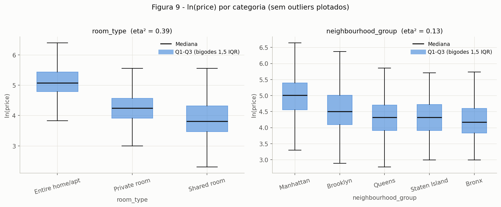

**Figura 9.** Boxplots de ln(price) por `room_type` e por `neighbourhood_group` (outliers omitidos para legibilidade), com η² em cada título.

**Conclusão.** `room_type` é o fator categórico mais forte: explica **38,7%** da variância de ln(price) (η² = 0,387; Kruskal–Wallis H = 17.909,
p ≈ 0). `neighbourhood_group` explica 13,0% (η² = 0,130, H = 5.558). Os bairros com 30 ou mais anúncios (108) explicam 27,7%
(η² = 0,277), mais que o distrito sozinho, então o bairro traz informação adicional dentro do distrito. Os bairros mais caros (mediana,
n ≥ 30) são Tribeca (299,5), NoHo (249,5) e Flatiron District (225); os mais baratos, Corona (40), Borough Park (51) e Woodhaven (51,5).

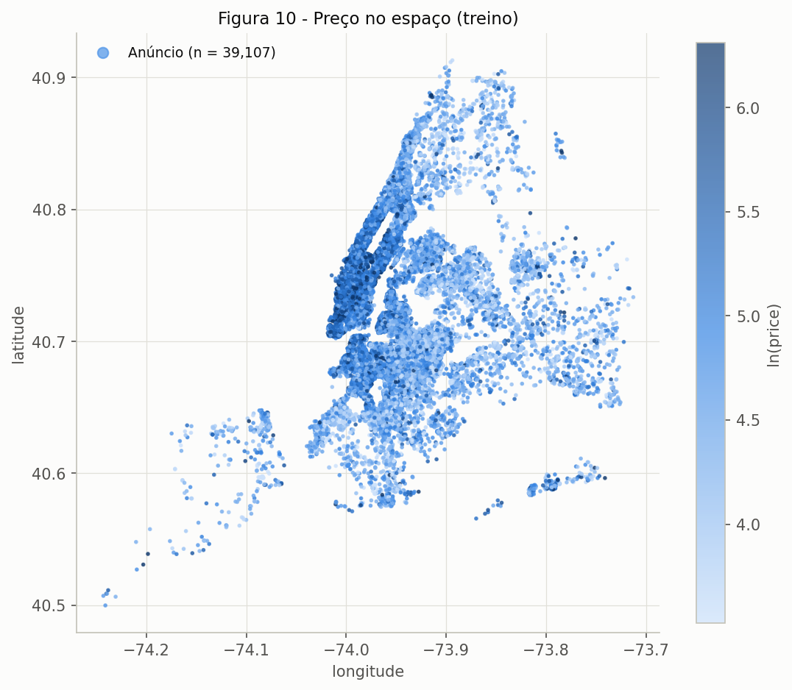

**Figura 10.** Cada anúncio do treino em suas coordenadas, colorido por ln(price) (escala sequencial de um só matiz).

**Conclusão.** O preço tem estrutura espacial clara: Manhattan e o noroeste do Brooklyn concentram os preços mais altos, e o preço cai à medida
que se afasta do centro. A distância até a Times Square (por uma conta simples em km) tem Spearman de −0,457 com ln(price), um pouco mais
forte que `longitude` sozinha (−0,440), e permanece em −0,407 só dentro de `Entire home/apt`. Isso explica por que a relação com
latitude e longitude isoladas é fraca ou não linear: o efeito é radial, não ao longo de um eixo.

| mediana de `price` (USD) | Entire home/apt | Private room | Shared room |
|---|---|---|---|
| Manhattan | 190 | 90 | 69 |
| Brooklyn | 149 | 65 | 35 |
| Queens | 120 | 59 | 37 |
| Staten Island | 102 | 55 | 52 |
| Bronx | 100 | 55 | 38 |

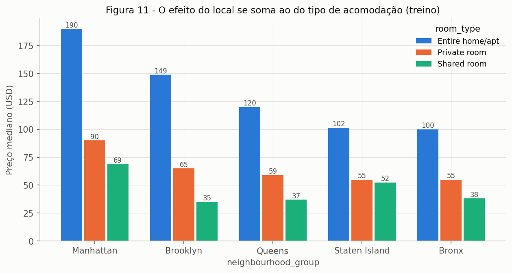

**Figura 11.** Mediana do preço por distrito e tipo de acomodação.

**Conclusão.** Os efeitos de local e de tipo se somam: dentro de cada distrito a ordem `Entire home/apt` > `Private room` > `Shared room` se
mantém (em Staten Island a diferença entre quarto privado e compartilhado é pequena, 55 contra 52 dólares, e a célula de quarto compartilhado tem
só 8 anúncios, então esse valor não é confiável), e dentro de `Entire home/apt` e de `Private room` a ordem dos distritos é a mesma
(Manhattan, Brooklyn, Queens, Staten Island/Bronx). Os dois fatores não se substituem: `neighbourhood_group` e `room_type` são
associados, mas fracamente (qui-quadrado = 1.260, V de Cramér = 0,127): Manhattan tem 60,9% de `Entire home/apt` e o Bronx 34,8%. O
`neighbourhood` está aninhado em `neighbourhood_group` (nenhum dos 220 bairros aparece em mais de um distrito), então o distrito é
quase uma versão agregada do bairro.

### C. Numérica × categórica

| par categórica \| numérica | H de Kruskal–Wallis | η² | faixa das medianas entre grupos | faixa do IQR entre grupos |
|---|---|---|---|---|
| `room_type` \| `availability_365` | 128,2 | 0,004 | 42 a 90 | 215 a 342 |
| `room_type` \| `minimum_nights` | 1.880,1 | 0,032 | 1 a 3 | 2 a 3 |
| `room_type` \| `number_of_reviews` | 27,3 | 0,001 | 4 a 5 | 16 a 24 |
| `neighbourhood_group` \| `availability_365` | 812,4 | 0,018 | 29 a 219 | 188 a 285 |
| `neighbourhood_group` \| `minimum_nights` | 625,3 | 0,016 | 2 a 3 | 2 a 5 |
| `neighbourhood_group` \| `number_of_reviews` | 242,1 | 0,006 | 4 a 11 | 18 a 38 |

(η² e Kruskal–Wallis foram calculados na escala em que cada feature é plotada, `log1p` para `minimum_nights` e `number_of_reviews`.)

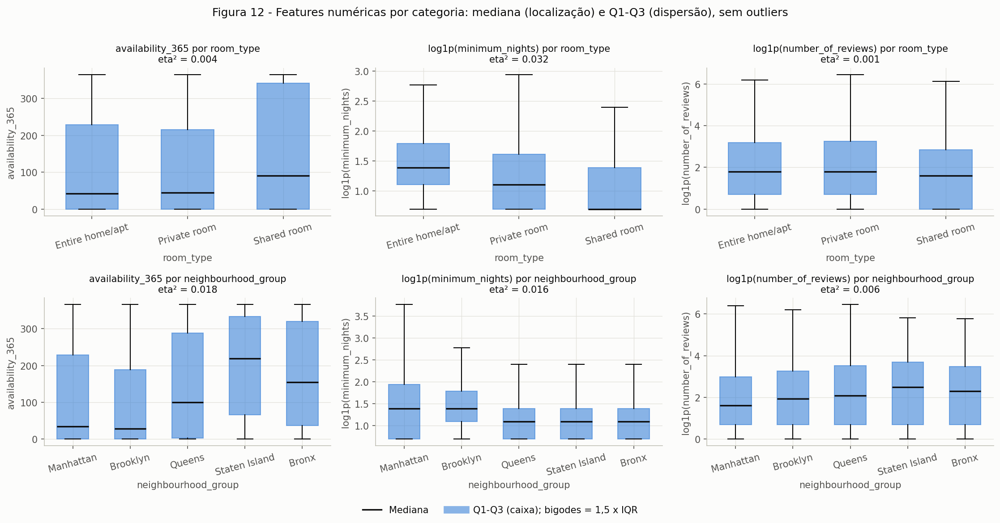

**Figura 12.** Boxplots de `availability_365`, `minimum_nights` e `number_of_reviews` por `room_type` (em cima) e por `neighbourhood_group` (embaixo).

**Conclusão.** Os grupos diferem tanto em **localização** quanto em **dispersão**, mas as diferenças explicam pouco (η² ≤ 0,032 em todos os
pares). Em `availability_365`, a mediana vai de 29 dias (Brooklyn) a 219 (Staten Island), e `Shared room` tem mediana 90 contra 43 dos
demais tipos e o maior IQR (342, praticamente toda a escala), ou seja, difere em posição e em espalhamento. `Entire home/apt` tem mediana de
3 noites mínimas contra 1 do `Shared room`, e a fração de anúncios com 30 noites ou mais é 13,0% em Manhattan contra 4,0% no Bronx. O ponto
importante para a modelagem é que as features numéricas **não replicam** o efeito das categóricas (η² quase zero): as duas famílias
trazem informação diferente e ambas devem entrar no modelo.

??? note "stage3_bivariate.py"

    ``` { .python .copy .select linenums='1' title="docs/projects/eda/code/stage3_bivariate.py" }
    --8<-- "docs/projects/eda/code/stage3_bivariate.py"
    ```

---

## 4. Pré-processamento

O destino dos dados é uma rede neural, que é sensível à escala das entradas, treina com gradiente e não lida com texto nem com `NaN`. Cada
escolha abaixo aponta para o achado que a motivou, e tudo que é "aprendido" vem do treino.

### A. Estratégias

| problema | achado que motiva | escolha | aprendido no treino |
|---|---|---|---|
| **Valores ausentes** | `reviews_per_month` ausente em 8.056 linhas de treino, todas com `number_of_reviews == 0` (1B); `name`, `host_name` e `last_review` serão descartadas | imputar `reviews_per_month` por **0** (constante). Não é preciso indicador de ausência: `number_of_reviews == 0` já o carrega | nada (constante) |
| **Outliers** | caudas pesadas (Figuras 2 e 3; assimetrias de 3,35 a 21,82); preço com assimetria 18,82 (Figura 1) | **winsorizar** as 4 features de cauda pesada no **P99,5** e usar **ln(price)** como alvo. Nenhuma linha é removida | limites do P99,5 por feature |
| **Codificação** | 3 categóricas; `neighbourhood` tem 220 níveis e 112 deles têm menos de 30 anúncios (Figura 5); 1 bairro só aparece no teste (1D) | **one-hot** com `min_frequency=30` e `handle_unknown="infrequent_if_exist"`: bairros com menos de 30 anúncios no treino e bairros nunca vistos vão para uma coluna "infrequente" | categorias e frequências |
| **Escala** | amplitudes de 0,41 (`latitude`) a 1.249 (`minimum_nights`); assimetria alta | `log1p` nas 4 features de cauda pesada, depois **StandardScaler** em todas as 7 numéricas | média e desvio |

**Detalhes e justificativas.**

- **Ordem na coluna de cauda pesada: winsorizar → imputar → `log1p` → padronizar.** O corte é feito antes da imputação para que o P99,5
  seja medido só nos valores observados (os 8.056 zeros estruturais imputados depois não devem puxar o quantil para baixo). O P99,5 de
  `reviews_per_month` é 8,38, igual ao da Etapa 2.
- **Por que winsorizar e não remover.** Os extremos de `minimum_nights`, `number_of_reviews` e `reviews_per_month` são raros (156 a 192
  linhas por feature) e podem ser erros ou casos legítimos; o corte mantém a linha e limita seu efeito sobre a escala e sobre a perda
  quadrática da rede. Os limites são 90, 257 e 8,38 (e 327 em `calculated_host_listings_count`, que não corta nenhuma linha). Remover
  linhas também mudaria o conjunto de teste.
- **Alvo em ln(price).** A rede é treinada em ln(price) (assimetria 18,82 → 0,59), e as previsões voltam a dólares com `exp`. Os 499
  outliers de preço pela cerca de Tukey em ln (1,28%) são anúncios plausíveis (398 são `Entire home/apt`) e **permanecem**; o log reduz a
  influência deles sem descartá-los. Uma ressalva: `exp` da previsão em ln estima a mediana condicional, e não a média, então a previsão em
  dólares tende a ficar abaixo da média.
- **One-hot em vez de embeddings ou *target encoding*.** É simples e não usa o alvo (o *target encoding* exigiria validação cruzada para não
  vazar). Embeddings aprendidos são uma alternativa para o projeto de modelagem.
- **Limiar 30.** Bairros com menos de 30 anúncios cobrem só 2,8% das linhas (Figura 5), então agrupá-los perde pouco e evita colunas quase vazias.
  Das 220 categorias, 108 ficam individuais e 1 coluna "infrequente" cobre as 112 restantes (mais qualquer bairro novo).

**Verificação no treino e no teste** (pipeline ajustado só com o treino):

| feature transformada | média no treino | desvio no treino | média no teste | desvio no teste |
|---|---|---|---|---|
| `minimum_nights` | −0,000 | 1,000 | −0,001 | 0,982 |
| `number_of_reviews` | −0,000 | 1,000 | −0,002 | 0,997 |
| `reviews_per_month` | 0,000 | 1,000 | 0,005 | 0,998 |
| `calculated_host_listings_count` | −0,000 | 1,000 | −0,005 | 0,975 |
| `latitude` | 0,000 | 1,000 | −0,009 | 1,000 |
| `longitude` | −0,000 | 1,000 | −0,005 | 0,999 |
| `availability_365` | 0,000 | 1,000 | 0,002 | 0,994 |

No treino a média é 0 e o desvio é 1 por construção. No teste os valores ficam **perto, mas não exatamente** de 0 e 1, que é o
comportamento esperado quando as estatísticas vêm só do treino. O bairro inédito do teste (Fort Wadsworth) vai para a coluna "infrequente",
e testei também uma linha com um bairro inventado ("Bairro Inexistente"): o `transform` funciona, sem `NaN`, e cai em "infrequente".

**Linhas afetadas pela estratégia de outliers.** O winsorizing atinge 162 linhas de treino em `minimum_nights`, 192 em `number_of_reviews`,
156 em `reviews_per_month` e 0 em `calculated_host_listings_count`. A união é de **479 linhas (1,22% do treino)**, das quais 31 têm duas ou
mais features cortadas. Nenhuma linha é removida. No teste, 35, 48 e 42 linhas ficam acima desses limites nas três colunas afetadas. Pelo
critério de Tukey no alvo, 499 linhas do treino (28 abaixo de 17,1 dólares e 471 acima de 706,8) e 127 do teste ficam fora dos limites
do treino; só 11 linhas são, ao mesmo tempo, outlier de preço e de feature.

### B. Redução de dimensionalidade

Todas as projeções usam as **124 colunas pré-processadas do treino**. O PCA é ajustado nas 39.107 linhas; t-SNE e UMAP usam uma **amostra de
5.000 linhas** do treino (semente 42), por custo computacional. As figuras 13 a 15 mostram a mesma amostra de 5.000 pontos.

**PCA.**

| componentes | variância acumulada |
|---|---|
| 2 (PC1 + PC2) | **40,1%** (22,3% + 17,8%) |
| 5 | 73,4% |
| 10 | 89,6% |
| 20 | 94,4% |
| 50 | 98,4% |

Para chegar a 80%, 90% e 95% da variância são necessários 7, 11 e 23 componentes.

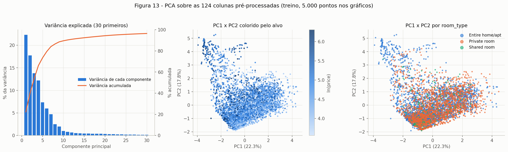

**Figura 13.** Variância explicada pelos 30 primeiros componentes, e PC1 × PC2 colorido por ln(price) e por `room_type`.

**Leitura das cargas (*loadings*).**

- **PC1 (22,3%):** `reviews_per_month` (0,61), `number_of_reviews` (0,59) e `minimum_nights` (−0,40). É o eixo da *atividade de avaliações*:
  anúncios muito avaliados e de estadia curta contra anúncios pouco avaliados e de estadia longa.
- **PC2 (17,8%):** `availability_365` (0,62), `calculated_host_listings_count` (0,60) e `minimum_nights` (0,38). É o eixo da
  *operação profissional*: anfitriões com muitos anúncios, disponíveis o ano todo e com estadias mínimas longas.
- **PC3 (13,8%):** `latitude` (0,86), com `neighbourhood_group_Manhattan` (0,29) e `neighbourhood_group_Brooklyn` (−0,33): é o eixo norte–sul.

**Conclusão.** Os primeiros componentes são dominados pelas **numéricas padronizadas** (variância 1 cada) e quase não mostram as colunas
one-hot, cuja variância individual é pequena. Por isso, em PC1 × PC2 não aparece gradiente de preço nem separação por `room_type`, que
dependem justamente de localização e de categorias. Dos 124 eixos, 11 componentes são necessários para 90% da variância: a estrutura é
razoavelmente comprimível, mas o que se comprime não é o que explica o preço.

**t-SNE e UMAP.** Dois valores de cada hiperparâmetro: `perplexity` = 15 e 50 (t-SNE) e `n_neighbors` = 15 e 50 (UMAP, com `min_dist` = 0,1).

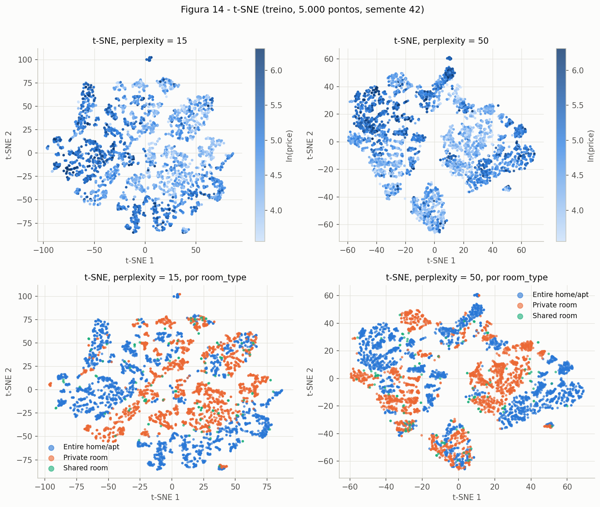

**Figura 14.** t-SNE em 2 dimensões: colorido por ln(price) (em cima) e por `room_type` (embaixo), `perplexity` = 15 (esquerda) e 50 (direita).

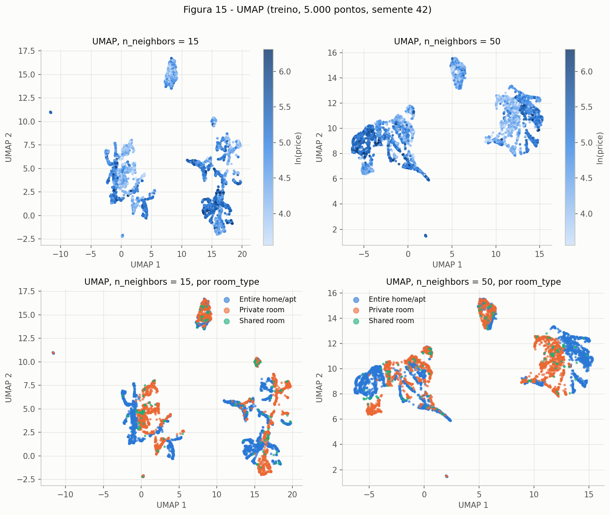

**Figura 15.** UMAP em 2 dimensões, com o mesmo esquema de cores, `n_neighbors` = 15 (esquerda) e 50 (direita).

Para comparar de forma objetiva (e não só olhando as figuras), calculei, nos 5.000 pontos e com 10 vizinhos: a *trustworthiness* (quanto
da vizinhança 2D vem da vizinhança real no espaço de 124 dimensões, de 0 a 1), a correlação de Spearman entre o ln(price) de cada ponto e a
média do ln(price) de seus 10 vizinhos na projeção, e a fração desses 10 vizinhos que tem o mesmo `room_type` e o mesmo
`neighbourhood_group` do ponto.

| projeção | trustworthiness | ρ do alvo com a média dos vizinhos | mesmo `room_type` | mesmo `neighbourhood_group` |
|---|---|---|---|---|
| PCA (2 componentes) | 0,794 | 0,204 | 0,518 | 0,467 |
| t-SNE (`perplexity` = 15) | 0,994 | 0,722 | 0,918 | 0,998 |
| t-SNE (`perplexity` = 50) | 0,995 | 0,723 | 0,921 | 0,996 |
| UMAP (`n_neighbors` = 15) | 0,985 | 0,700 | 0,894 | 0,996 |
| UMAP (`n_neighbors` = 50) | 0,982 | 0,692 | 0,878 | 0,996 |
| *referência: espaço original de 124 dim.* | — | 0,744 | — | — |

O acordo esperado ao acaso seria 0,479 para `room_type` e 0,376 para `neighbourhood_group`.

**Conclusão (o que as projeções não lineares revelam que o PCA não).**

1. **Elas preservam a vizinhança muito melhor que o PCA** (trustworthiness de 0,98 a 0,995 contra 0,794): a estrutura de 124 dimensões
   não cabe em 2 eixos lineares, mas cabe em 2 eixos não lineares.
2. **Elas separam os distritos quase perfeitamente** (0,996 a 0,998 dos vizinhos são do mesmo distrito, contra 0,376 ao acaso e 0,467 no PCA)
   e também, dentro dos blocos, separam os tipos de acomodação (0,88 a 0,92, contra 0,479 ao acaso). Os grandes blocos das Figuras 14 e 15
   são, em essência, **o distrito** (as 5 colunas one-hot do distrito deixam anúncios de distritos diferentes sempre distantes), e a
   subdivisão dentro deles reflete `room_type` e bairro.
3. **Aparece gradiente de preço dentro dos blocos:** a correlação entre o preço de um ponto e o de seus vizinhos sobe de 0,204 (PCA) para
   cerca de 0,70 (UMAP) e 0,72 (t-SNE), perto dos 0,744 do espaço original. É a evidência de que o preço é, em grande parte, função de
   localização e tipo (resultado 3B), e de que uma rede neural com a entrada completa tem sinal suficiente para trabalhar.
4. **Os resultados são estáveis em relação aos hiperparâmetros:** mudar a `perplexity` de 15 para 50 ou `n_neighbors` de 15 para 50 altera
   as métricas em menos de 0,02, embora o desenho dos blocos mude.

**Ressalva importante de interpretação.** Em t-SNE e UMAP, o **tamanho dos agrupamentos e as distâncias entre eles não têm interpretação
direta**. Aqui, além disso, os blocos são em boa parte um efeito da codificação one-hot do distrito, e não "grupos naturais de anúncios"
descobertos pelos dados. Por isso o PCA **não** entra no pipeline: ele descartaria justamente a informação categórica que mais explica o
preço. As projeções são usadas só para entender os dados.

### C. Pipeline

O pipeline (`Pipeline` + `ColumnTransformer`) está em `code/preprocessing.py` e é importável pelo projeto de modelagem:

```python
from preprocessing import build_pipeline, target_to_model, target_to_price
import common as C

train, test = C.load_split()
pipe = build_pipeline()                              # ColumnTransformer: "heavy", "plain" e "cat"
X_train = pipe.fit_transform(train[C.FEATURES])      # fit SOMENTE no treino
X_test = pipe.transform(test[C.FEATURES])            # o teste só passa por transform
y_train = target_to_model(train["price"])            # ln(price)
```

??? note "preprocessing.py"

    ``` { .python .copy .select linenums='1' title="docs/projects/eda/code/preprocessing.py" }
    --8<-- "docs/projects/eda/code/preprocessing.py"
    ```

**Verificações (saída de `stage4_preprocessing.py`):**

- **Sem `NaN`:** 0 `NaN` após o pipeline, no treino e no teste.
- **`shape`:** entrada `(39107, 10)` → saída `(39107, 124)` no treino; entrada `(9777, 10)` → saída `(9777, 124)` no teste.
- **As 124 colunas:** 4 de cauda pesada + 3 numéricas + 5 de `neighbourhood_group` + 109 de `neighbourhood` (108 bairros e 1 "infrequente") + 3 de `room_type`.
- **Nomes das features** (na ordem das colunas):

```text
minimum_nights
number_of_reviews
reviews_per_month
calculated_host_listings_count
latitude
longitude
availability_365
neighbourhood_group_Bronx
neighbourhood_group_Brooklyn
neighbourhood_group_Manhattan
neighbourhood_group_Queens
neighbourhood_group_Staten Island
neighbourhood_Allerton
neighbourhood_Arverne
neighbourhood_Astoria
neighbourhood_Battery Park City
neighbourhood_Bay Ridge
neighbourhood_Bayside
neighbourhood_Bedford-Stuyvesant
neighbourhood_Bensonhurst
neighbourhood_Boerum Hill
neighbourhood_Borough Park
neighbourhood_Briarwood
neighbourhood_Brighton Beach
neighbourhood_Brooklyn Heights
neighbourhood_Brownsville
neighbourhood_Bushwick
neighbourhood_Canarsie
neighbourhood_Carroll Gardens
neighbourhood_Chelsea
neighbourhood_Chinatown
neighbourhood_Civic Center
neighbourhood_Clinton Hill
neighbourhood_Cobble Hill
neighbourhood_Columbia St
neighbourhood_Concourse
neighbourhood_Corona
neighbourhood_Crown Heights
neighbourhood_Cypress Hills
neighbourhood_DUMBO
neighbourhood_Ditmars Steinway
neighbourhood_Downtown Brooklyn
neighbourhood_East Elmhurst
neighbourhood_East Flatbush
neighbourhood_East Harlem
neighbourhood_East New York
neighbourhood_East Village
neighbourhood_Elmhurst
neighbourhood_Financial District
neighbourhood_Flatbush
neighbourhood_Flatiron District
neighbourhood_Flatlands
neighbourhood_Flushing
neighbourhood_Fordham
neighbourhood_Forest Hills
neighbourhood_Fort Greene
neighbourhood_Fort Hamilton
neighbourhood_Glendale
neighbourhood_Gowanus
neighbourhood_Gramercy
neighbourhood_Gravesend
neighbourhood_Greenpoint
neighbourhood_Greenwich Village
neighbourhood_Harlem
neighbourhood_Hell's Kitchen
neighbourhood_Inwood
neighbourhood_Jackson Heights
neighbourhood_Jamaica
neighbourhood_Kensington
neighbourhood_Kingsbridge
neighbourhood_Kips Bay
neighbourhood_Little Italy
neighbourhood_Long Island City
neighbourhood_Longwood
neighbourhood_Lower East Side
neighbourhood_Maspeth
neighbourhood_Middle Village
neighbourhood_Midtown
neighbourhood_Midwood
neighbourhood_Morningside Heights
neighbourhood_Mott Haven
neighbourhood_Murray Hill
neighbourhood_NoHo
neighbourhood_Nolita
neighbourhood_Ozone Park
neighbourhood_Park Slope
neighbourhood_Port Morris
neighbourhood_Prospect Heights
neighbourhood_Prospect-Lefferts Gardens
neighbourhood_Queens Village
neighbourhood_Red Hook
neighbourhood_Rego Park
neighbourhood_Richmond Hill
neighbourhood_Ridgewood
neighbourhood_Rockaway Beach
neighbourhood_Roosevelt Island
neighbourhood_Rosedale
neighbourhood_Sheepshead Bay
neighbourhood_SoHo
neighbourhood_South Ozone Park
neighbourhood_South Slope
neighbourhood_Springfield Gardens
neighbourhood_St. Albans
neighbourhood_St. George
neighbourhood_Sunnyside
neighbourhood_Sunset Park
neighbourhood_Theater District
neighbourhood_Tompkinsville
neighbourhood_Tribeca
neighbourhood_Two Bridges
neighbourhood_Upper East Side
neighbourhood_Upper West Side
neighbourhood_Wakefield
neighbourhood_Washington Heights
neighbourhood_West Village
neighbourhood_Williamsbridge
neighbourhood_Williamsburg
neighbourhood_Windsor Terrace
neighbourhood_Woodhaven
neighbourhood_Woodside
neighbourhood_infrequent_sklearn
room_type_Entire home/apt
room_type_Private room
room_type_Shared room
```

??? note "stage4_preprocessing.py"

    ``` { .python .copy .select linenums='1' title="docs/projects/eda/code/stage4_preprocessing.py" }
    --8<-- "docs/projects/eda/code/stage4_preprocessing.py"
    ```

---

## 5. Síntese

### Principais achados

1. **O alvo é muito assimétrico, e o log resolve** (Figura 1): assimetria de 18,82 para 0,59 em ln(price). O modelo deve prever ln(price).
2. **Localização e tipo de acomodação explicam o preço; as numéricas isoladas explicam pouco** (Figuras 8, 9 e 12). `room_type` explica 38,7% da
   variância de ln(price), o `neighbourhood` (108 bairros) 27,7%, o distrito 13,0%, e nenhuma feature numérica passa de |ρ| = 0,44
   (`longitude`); as outras ficam abaixo de 0,14.
3. **O preço tem estrutura radial** (Figura 10): decresce com a distância ao centro de Manhattan (ρ = −0,457), por isso latitude e longitude
   separadas são fracas e a rede precisa combinar as duas (ou receber a distância).
4. **Efeitos aditivos de local e tipo** (Figura 11): a ordem dos tipos se mantém em todos os distritos.
5. **Caudas pesadas nas features** (Figuras 2 e 3) tratadas com winsorizing em P99,5 + `log1p` + padronização (479 linhas de treino afetadas).
6. **Ausência estrutural** (1B): `reviews_per_month` é 0 quando não há avaliações, e a imputação por 0 é exata.
7. **Alta cardinalidade em `neighbourhood`** (Figura 5): 112 dos 220 bairros têm menos de 30 anúncios e viram uma coluna "infrequente".
8. **As projeções não lineares mostram que o preço é recuperável a partir da entrada completa** (Figuras 14 e 15 e tabela de 4B), ao contrário do PCA (Figura 13).

### Riscos para a modelagem e plano de tratamento

| risco | evidência | plano |
|---|---|---|
| **Mesmo anfitrião no treino e no teste** (vazamento por grupo) | 31,0% das linhas de teste (3.032 de 9.777) pertencem a um `host_id` que também aparece no treino; anfitriões tendem a cobrar preços parecidos | validar com `GroupKFold` por `host_id` no projeto de modelagem e relatar também uma estimativa sem sobreposição de anfitriões |
| **Erro dominado pela cauda do preço** | os 21 anúncios com 5.000 dólares ou mais e os 236 com 1.000 ou mais pesam muito no erro em dólares | treinar em ln(price), reportar MAE e RMSE em ln **e** em dólares; olhar também a mediana do erro absoluto |
| **Referência de desempenho** (constante, sem modelo) | prever sempre a média do treino dá RMSE de 264,5 dólares e MAE de 94,1 no teste; prever sempre a média de ln(price) dá RMSE de 0,701 em ln | qualquer modelo precisa bater esses números; são o piso de comparação |
| **Bairros raros ou inéditos** | 112 dos 220 bairros têm menos de 30 anúncios; 1 bairro só aparece no teste | já tratado pelo agrupamento em "infrequente" (`handle_unknown="infrequent_if_exist"`); avaliar o erro nesses grupos |
| **Sinal linear fraco nas numéricas** | maior |ρ| numérico de 0,44; relações não monotônicas (Figura 8) | usar rede com camadas ocultas não lineares; considerar a distância ao centro ou cruzar localização e tipo |
| **Redundância entre features** | `number_of_reviews` × `reviews_per_month` (ρ = 0,71); VIF máximo de 2,57 | manter as duas (VIF baixo) e comparar com um modelo sem uma delas |
| **`availability_365 == 0` é ambíguo** | 36,0% dos anúncios; mediana de preço 100 contra 110 | testar uma coluna indicadora `availability_365 == 0` |
| **Viés do `exp` ao voltar para dólares** | `exp(E[ln y])` estima a mediana condicional | reportar as métricas em ln e, em dólares, tratar o viés se necessário |
| **Estimativas instáveis em células pequenas** | Staten Island × `Shared room` tem 8 anúncios | não tirar conclusões por célula nesses grupos |
| **Dados de um único instante de 2019** | os dados são um retrato, sem dimensão temporal para validar | o modelo vale para esse retrato; não extrapolar para outros períodos |

### Resumo dos resultados

| # | Resumo dos resultados | Valor |
|---|---|---|
| 1 | Dataset, tarefa e alvo | NYC Airbnb (`AB_NYC_2019`, Kaggle); regressão; alvo `price` (USD por noite) |
| 2 | Instâncias × features (numéricas / categóricas) | 48.895 × 16 no arquivo; 10 features usadas (7 numéricas / 3 categóricas) + alvo |
| 3 | Coluna com mais ausentes e porcentagem | `reviews_per_month` e `last_review`: 10.052 linhas cada (20,56%) |
| 4 | Colunas descartadas e o motivo | `id`, `host_id` (identificadores); `name`, `host_name` (texto livre); `last_review` (redundante com `number_of_reviews`, 20,56% ausente) |
| 5 | Média e mediana do alvo | média 152,28 · mediana 106 (USD, treino) |
| 6 | Tamanho de treino e teste | 39.107 (80%) e 9.777 (20%), após remover 11 linhas com `price <= 0` |
| 7 | Par numérico mais correlacionado e seu valor | `number_of_reviews` × `reviews_per_month`: Spearman = 0,71 |
| 8 | Linhas afetadas pela estratégia de outliers | 479 linhas de treino (1,22%) winsorizadas no P99,5; 0 removidas |
| 9 | Variância explicada por PC1 + PC2 | 40,1% (22,3% + 17,8%) |
| 10 | `shape` de treino e teste após o pipeline | treino (39107, 124) · teste (9777, 124) |
