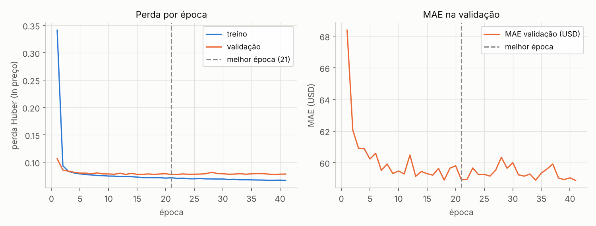
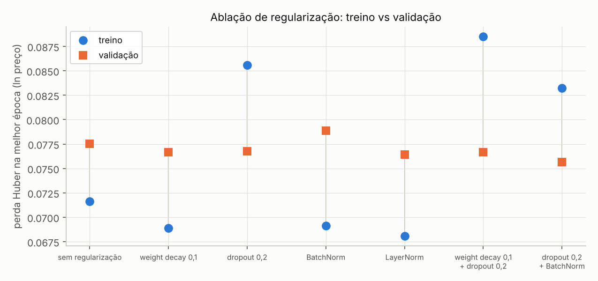
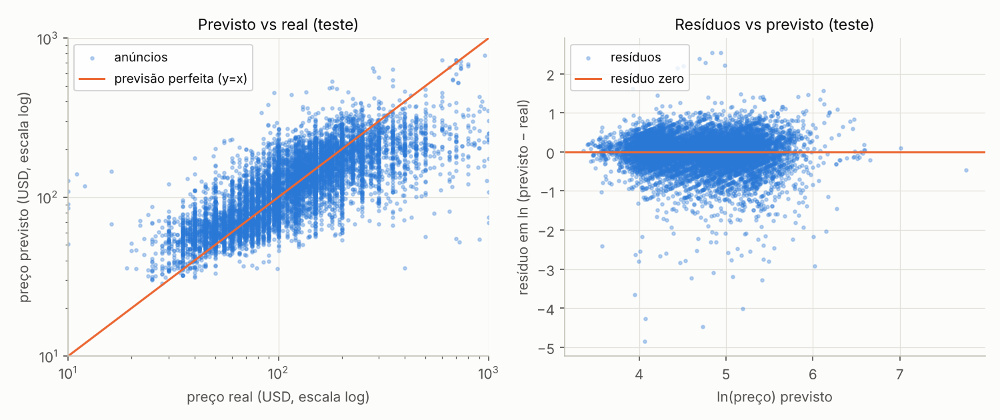
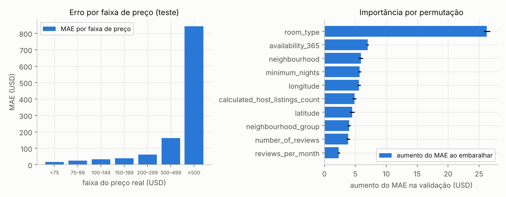

# Regressão — prever o preço de anúncios do Airbnb em Nova York com uma rede neural

!!! abstract "Enunciado"

    [Projects → Supervised learning](https://insper.github.io/ann-dl/2026.2/projects/supervised/){:target='_blank'}

Este relatório continua a [EDA](../eda/index.md): mesmo dataset (NYC Airbnb Open Data), mesma tarefa (**regressão do preço da diária**), mesma limpeza, mesmo split treino/teste (80/20, seed 42, estratificado por decis do preço) e o mesmo pipeline de pré-processamento, importado de `docs/projects/eda/code/` sem copiar.

## 0. Ponto de partida

**Pipeline da EDA.** `code/reg_common.py` importa `common.py` e `preprocessing.py` da EDA. Os passos, todos aprendidos só no treino: remover 11 anúncios com preço ≤ 0 (regra, antes do split); winsorizar no P99,5 as quatro colunas de cauda pesada; imputar `reviews_per_month` com 0 (ausente exatamente quando `number_of_reviews == 0`); `log1p` e padronização; padronizar latitude, longitude e `availability_365`; one-hot de `neighbourhood_group`, `neighbourhood` (categorias com menos de 30 anúncios viram "infrequente") e `room_type`. Resultado: **119 colunas** de entrada. O alvo é **ln(preço)**, e todas as métricas deste relatório são calculadas de volta em **dólares**.

!!! note "Correções da nota da EDA"

    Até a escrita deste relatório a EDA ainda não tinha sido corrigida, então não haviam correções a incorporar; o pipeline foi importado exatamente como está no repositório.

**Validação.** Como o teste só pode ser usado uma vez, a validação sai do treino da EDA: 15% do treino, estratificada pelos mesmos decis de preço, seed 42. O pré-processador é ajustado só nas linhas de treino restantes.

| conjunto | linhas |
|---|---|
| Treino (ajuste da rede e do pré-processador) | 33.240 |
| Validação (early stopping, escolha de configuração) | 5.867 |
| Teste (usado uma vez, no passo 5) | 9.777 |
| Total (após remover 11 anúncios com preço ≤ 0) | 48.884 |

!!! warning "Risco conhecido do split"

    Na EDA vimos que 31,0% das linhas de teste pertencem a um `host_id` que também aparece no treino. A validação foi sorteada do mesmo jeito que o teste (aleatória), então ela reproduz esse vazamento parcial de forma comparável: a nota no teste é parecida com a da validação, mas ambas são otimistas para anfitriões que ainda não aparecem no treino.

**Métrica principal e critério de sucesso (fixados antes de treinar qualquer rede).** Métrica principal: **MAE em dólares (USD)**, porque é fácil de explicar ("erro médio em dólares por diária") e é menos dominada pelos poucos anúncios de preço absurdo do que o RMSE. Critério: **a rede deve ter MAE pelo menos 5% menor que o do melhor baseline linear.** Com o Ridge no valor de MAE de validação 61,00 (passo 1), isso dá **MAE ≤ 57,95 USD**. O critério foi escrito em `code/step0_criterion.py` depois dos baselines e antes de qualquer treino de rede. Escolhi 5% (e não 15%) depois de ver que, nesses dados, uma floresta aleatória só melhora o Ridge em ~5%: o sinal disponível nas 10 colunas é limitado.

## 1. Baselines

Todos usam o mesmo pipeline, são treinados no treino e avaliados na **validação**. Os modelos de scikit-learn aprendem `ln(preço)` e voltam a dólares com `exp`; as duas linhas "Constante ... USD" são referências sem o log.

| modelo (validação) | MAE (USD) | RMSE (USD) | R² |
|---|---|---|---|
| Dummy média (ln) | 85,95 | 240,11 | -0,031 |
| Dummy mediana (ln) | 85,80 | 241,40 | -0,042 |
| Ridge alpha=0.1 | 61,01 | 221,37 | 0,124 |
| Ridge alpha=1 | 61,01 | 221,39 | 0,124 |
| Ridge alpha=10 | 61,00 | 221,52 | 0,123 |
| Ridge alpha=100 | 61,13 | 222,30 | 0,116 |
| Floresta aleatória | 57,73 | 215,64 | 0,169 |
| HistGradientBoosting | 58,18 | 217,41 | 0,155 |
| Constante média USD | 93,85 | 236,51 | -0,000 |
| Constante mediana USD | 85,80 | 241,40 | -0,042 |

O baseline trivial (prever a mediana do preço) erra 85,80 USD. O Ridge, que só combina as colunas linearmente, cai para 61,00 (−29%), com R² de 0,123: `room_type` e a localização explicam boa parte do preço. A floresta aleatória (57,73) e o gradient boosting (58,18) melhoram o Ridge em ~5%; são o teto realista para esta tabela, e **se a rede empatar com eles, isso será dito** (e é o que acontece, ver passo 5). A melhor referência linear é o **Ridge com alpha=10** (MAE 61,00); a diferença entre os alphas é de centavos.

## 2. A rede

Arquitetura escolhida (`code/mlp.py`): **MLP 119 → 256 → 128 → 64 → 1**, ReLU, dropout 0,2 após cada camada oculta, saída de **1 unidade linear**.

- **Camadas e larguras.** Os dados são uma tabela com 119 colunas, sem estrutura espacial ou sequencial, então um MLP é a arquitetura natural. Três camadas ocultas em funil (256-128-64) deixam a rede combinar interações (ex.: tipo de quarto × bairro) em níveis; a busca do passo 4 comparou 1, 2 e 3 camadas.
- **Ativação.** ReLU: barata, não satura e combina com a inicialização He.
- **Inicialização.** He/Kaiming normal nos pesos e zeros nos vieses, o par recomendado para ReLU, que mantém a variância das ativações estável entre camadas.
- **Saída.** Uma unidade linear, sem ativação, porque o alvo ln(preço) é um número real qualquer.
- **Perda.** **Huber com δ = 0,5**, em ln(preço). A EDA encontrou 499 anúncios de treino fora da cerca de Tukey e preços de até 10.000 USD. Com MSE esses poucos pontos dominariam o gradiente; com Huber o erro é quadrático para resíduos pequenos (menos de 0,5 em ln, ou seja, cerca de ±65% do preço) e linear para os grandes, e a métrica final (MAE) é linear também.
- **Parâmetros vs linhas.** A rede escolhida tem **71.937 parâmetros** para **33.240 linhas de treino**, ou seja, cerca de **2,2 parâmetros por linha**. Isso é mais do que linhas, então a rede pode memorizar o treino, e por isso a regularização e o early stopping são parte essencial do desenho (passos 3 e 4). A rede base do passo 3 (119-128-64-1) tem 23.681 parâmetros (0,71 por linha).

O código está em `code/mlp.py` e `code/train.py`:

??? note "mlp.py"

    ```python
    --8<-- "docs/projects/regression/code/mlp.py"
    ```

## 3. Treinamento

Configuração da rede base (sem regularização): **AdamW**, lr = 1e-3, `weight_decay` = 0, lote de 256, até 200 épocas, paciência de 20.

- **Otimizador (AdamW).** Adam adapta o passo por parâmetro, o que ajuda com colunas de escalas diferentes e converge sem muito ajuste; AdamW separa o *weight decay* do gradiente, o que torna a regularização do passo 4 bem definida.
- **Taxa de aprendizado (1e-3).** Valor padrão do Adam; foi comparada com 3e-4 e 3e-3 na busca do passo 4 (3e-3 foi um pouco pior em média: 59,04 contra 58,8 USD).
- **Lote (256).** 130 atualizações por época, ruído suficiente para generalizar e um treino de poucos segundos por rede em CPU.
- **Épocas e early stopping.** O teto de 200 épocas nunca é atingido: a validação para de melhorar bem antes. Se a perda de validação não melhora por 20 épocas, o treino para e **os pesos da melhor época são restaurados** (cópia do `state_dict`).



/// caption
Figura 1. Perda Huber de treino e validação e MAE de validação por época, rede base (119-128-64-1, sem regularização).
///

**Leitura.** A perda cai quase tudo nas 2 ou 3 primeiras épocas (de 0,34 para ~0,09) e depois só melhora devagar. A validação atinge o mínimo na **época 21** (perda 0,0775, MAE 58,92 USD) e a partir daí fica estável, enquanto a perda de treino continua caindo (0,0716 na época 21, 0,0666 ao parar na 41): é aí que começa o *overfitting* leve, uma diferença que cresce de 0,006 para 0,012. O MAE de validação oscila ±0,5 USD de época para época, mostrando que diferenças menores que isso não são confiáveis. Não há divergência: o overfitting é suave e o early stopping é suficiente para controlá-lo.

??? note "train.py"

    ```python
    --8<-- "docs/projects/regression/code/train.py"
    ```

## 4. Regularização e hiperparâmetros

**Comparação de técnicas** (rede 128-64, seed 42, todas na validação; `code/step4_search.py`):

| configuração | melhor época | perda treino | perda val. | MAE val. (USD) |
|---|---|---|---|---|
| sem regularização | 21 | 0,0716 | 0,0775 | 58,92 |
| weight decay 0,1 | 39 | 0,0689 | 0,0766 | 58,67 |
| dropout 0,2 | 58 | 0,0856 | 0,0767 | 58,93 |
| BatchNorm | 26 | 0,0691 | 0,0789 | 59,19 |
| LayerNorm | 21 | 0,0681 | 0,0764 | 58,57 |
| weight decay 0,1 + dropout 0,2 | 79 | 0,0885 | 0,0767 | 58,93 |
| dropout 0,2 + BatchNorm | 72 | 0,0832 | 0,0757 | 58,49 |



/// caption
Figura 2. Perda de treino e de validação na melhor época para cada técnica de regularização.
///

**Leitura.** *Weight decay* (0,1), *LayerNorm* e *dropout 0,2 + BatchNorm* reduzem a perda de validação em relação à rede sem regularização (de 0,0775 para 0,0757–0,0766), mas os ganhos em MAE são pequenos (de 58,92 para 58,49–58,67 USD) e menores que a oscilação entre épocas e sementes que vimos no passo 3. O dropout aumenta a perda de treino (0,0856) porque ela é medida com o dropout ligado; por isso os valores de treino com dropout não são comparáveis aos sem dropout. *BatchNorm* sozinho piorou um pouco (59,19). Conclusão: com 10 colunas e uma rede pequena, a regularização ajuda pouco, mas não prejudica, e o dropout permite redes maiores sem overfitting, como a busca mostra.

**Busca de hiperparâmetros.** 36 configurações em grade (3 estruturas × 3 taxas de aprendizado × 4 regularizações), todas com seed 42, ordenadas pelo **MAE de validação** (a escolha usa só a validação). Abaixo, as 10 melhores e as 3 piores (a tabela completa está em `results/search.csv`):

| # | configuração (camadas · lr · regularização) | parâmetros | melhor época | MAE val. (USD) |
|---|---|---|---|---|
| 1 | 256-128-64 · lr 0.001 · dropout 0,2 | 71.937 | 80 | 58,06 |
| 2 | 256-128-64 · lr 0.0003 · dropout 0,2 + wd 0,1 | 71.937 | 120 | 58,16 |
| 3 | 256-128-64 · lr 0.001 · dropout 0,2 + wd 0,1 | 71.937 | 71 | 58,26 |
| 4 | 256-128-64 · lr 0.0003 · nenhuma | 71.937 | 21 | 58,39 |
| 5 | 256-128-64 · lr 0.0003 · wd 0,1 | 71.937 | 21 | 58,39 |
| 6 | 256-128-64 · lr 0.003 · dropout 0,2 | 71.937 | 31 | 58,55 |
| 7 | 128-64 · lr 0.001 · wd 0,1 | 23.681 | 39 | 58,67 |
| 8 | 128-64 · lr 0.0003 · wd 0,1 | 23.681 | 56 | 58,71 |
| 9 | 256-128-64 · lr 0.001 · wd 0,1 | 71.937 | 11 | 58,77 |
| 10 | 128-64 · lr 0.003 · dropout 0,2 | 23.681 | 43 | 58,80 |

(...)

| # | configuração (camadas · lr · regularização) | parâmetros | melhor época | MAE val. (USD) |
|---|---|---|---|---|
| 34 | 64 · lr 0.003 · nenhuma | 7.745 | 18 | 59,23 |
| 35 | 128-64 · lr 0.003 · wd 0,1 | 23.681 | 20 | 59,29 |
| 36 | 64 · lr 0.003 · dropout 0,2 + wd 0,1 | 7.745 | 52 | 59,41 |

**Escolhida: 256-128-64, lr 1e-3, dropout 0,2** (MAE de validação 58,06 USD, 71.937 parâmetros). Duas ressalvas: (1) a faixa inteira da busca é estreita, 58,06–59,41 USD (média 58,89, desvio 0,32), e a diferença entre a primeira e a décima colocada (0,74 USD) é do tamanho do ruído, então a escolha tem algum **viés do vencedor** (a configuração ganhou também por sorte da semente); (2) as redes de 3 camadas ficaram em média melhores (58,59) que as de 2 (58,93) e 1 (59,15), e a taxa 3e-3 foi a pior (59,04 contra ~58,8).

**A rede escolhida não atingiu o critério do passo 0 na validação**: 58,06 > 57,95, uma redução de 4,8% sobre o Ridge (61,00), e não de 5%.

??? note "step4_search.py"

    ```python
    --8<-- "docs/projects/regression/code/step4_search.py"
    ```

## 5. Avaliação no teste

A configuração escolhida (256-128-64, lr 1e-3, dropout 0,2) foi treinada com **5 sementes** (42–46) e avaliada **uma única vez** no teste (`code/step5_test.py`, que cria um arquivo-trava para impedir uma segunda execução). Os baselines foram treinados no mesmo treino e avaliados no mesmo teste. **O teste não influenciou nenhuma escolha**: configuração, critério, lr, arquitetura e regularização saíram da validação; o early stopping também usa só a validação.

| modelo (teste) | MAE (USD) | RMSE (USD) | R² |
|---|---|---|---|
| Dummy (média de ln) | 86,05 | 267,78 | -0,025 |
| Ridge (alpha=10) | 62,16 | 252,36 | 0,090 |
| Floresta aleatória | 58,23 | 246,33 | 0,133 |
| HistGradientBoosting | 58,75 | 247,16 | 0,127 |
| **MLP (média ± dp, 5 sementes)** | **58,96 ± 0,10** | **248,98 ± 0,89** | **0,114 ± 0,006** |

Por semente:

| semente | melhor época | época em que parou | MAE | RMSE | R² |
|---|---|---|---|---|---|
| 42 | 80 | 100 | 58,94 | 247,68 | 0,123 |
| 43 | 83 | 103 | 58,83 | 248,53 | 0,117 |
| 44 | 56 | 76 | 58,97 | 249,50 | 0,110 |
| 45 | 50 | 70 | 59,12 | 249,91 | 0,107 |
| 46 | 57 | 77 | 58,96 | 249,30 | 0,112 |

**Critério do passo 0.** O critério era relativo: MAE pelo menos 5% menor que o do melhor baseline linear. No teste, a rede tem MAE de **58,96 ± 0,10** contra **62,16** do Ridge, uma redução de **5,1%**, então o critério foi **cumprido por margem mínima** (na validação ele não havia sido: 4,8%). O limiar absoluto de 57,95 USD (que valia para a validação) **não** é atingido no teste (58,96), e vale registrar que o conjunto de teste é um pouco mais difícil que a validação para todos os modelos (o Ridge passa de 61,00 para 62,16).

**A diferença para o baseline é maior que a variação entre sementes?** Sim, para o Ridge: a diferença é de 3,20 USD contra um desvio de 0,10 entre sementes (a variação entre sementes é desprezível diante da diferença). Mas **a rede não é melhor que as árvores**: a floresta aleatória fica em 58,23 e o gradient boosting em 58,75, contra 58,96 da rede. A floresta é 0,73 USD melhor, ou 7 desvios da rede (mas é uma só execução, sem sementes). Em RMSE e R² vale a mesma ordem. Ou seja, **as árvores empatam ou ganham da rede** neste dataset.



/// caption
Figura 3. Esquerda: preço previsto vs preço real no teste (escalas logarítmicas). Direita: resíduo em ln vs ln(preço) previsto (semente 42).
///

**Leitura.** A nuvem acompanha a diagonal na faixa de 50 a 300 USD, mas **achata**: preços baixos são superestimados e preços altos, subestimados (as previsões ficam presas entre ~35 e ~700 USD, mesmo quando o preço real passa de 1000). Os resíduos em ln são centrados em zero, sem funil, mas com caudas longas para os dois lados (de −5 a +2,5): o erro grande ocorre quando o preço do anúncio foge do que as 10 colunas conseguem explicar. R² de 0,11 em dólares é baixo porque o RMSE em dólares é dominado por poucos anúncios muito caros (ver passo 6); em ln, o RMSE é 0,45 contra 0,70 do baseline constante, ou seja, a rede explica cerca de 59% da variância de ln(preço).

!!! note "MAPE"

    Não reporto MAPE: com preços de até 10.000 USD e erros relativos assimétricos (um erro de +100% e de −50% pesam diferente), a métrica fica instável e não acrescenta nada além do MAE em ln, que está nas tabelas do passo 6.

??? note "step5_test.py"

    ```python
    --8<-- "docs/projects/regression/code/step5_test.py"
    ```

## 6. Análise de erro

Os números abaixo usam as previsões do teste (semente 42), que já existiam depois do passo 5; nenhuma decisão do modelo depende delas.

**Por grupo de bairros** (MAE em USD; "viés" = previsto − real, negativo = subestima; "MAE em ln" é o erro relativo, comparável entre grupos):

| bairro (grupo) | n | MAE (USD) | viés médio (USD) | MAE em ln |
|---|---|---|---|---|
| Manhattan | 4301 | 82,93 | -43,41 | 0,33 |
| Brooklyn | 4035 | 43,21 | -15,13 | 0,30 |
| Staten Island | 78 | 37,60 | -18,88 | 0,33 |
| Queens | 1144 | 31,51 | -8,05 | 0,29 |
| Bronx | 219 | 28,38 | -6,66 | 0,31 |

**Por tipo de quarto:**

| tipo de quarto | n | MAE (USD) | viés médio (USD) | MAE em ln |
|---|---|---|---|---|
| Entire home/apt | 5129 | 84,44 | -40,70 | 0,34 |
| Private room | 4428 | 31,06 | -11,08 | 0,28 |
| Shared room | 220 | 25,66 | -9,52 | 0,32 |

**Por faixa do preço real:**

| faixa do preço real (USD) | n | MAE (USD) | viés médio (USD) | MAE em ln |
|---|---|---|---|---|
| < 75 | 2773 | 17,72 | 15,40 | 0,29 |
| 75–99 | 1601 | 24,66 | 11,95 | 0,25 |
| 100–149 | 2030 | 32,86 | 11,71 | 0,26 |
| 150–199 | 1431 | 39,76 | -4,90 | 0,25 |
| 200–299 | 1156 | 62,09 | -42,73 | 0,32 |
| 300–499 | 544 | 162,01 | -157,25 | 0,62 |
| ≥ 500 | 242 | 843,48 | -840,97 | 1,32 |



/// caption
Figura 4. Esquerda: MAE no teste por faixa de preço real. Direita: importância por permutação na validação (aumento do MAE ao embaralhar cada coluna original, média e desvio de 10 repetições).
///

**Padrões e hipóteses.**

1. **Manhattan tem o maior erro absoluto (MAE 82,93 USD, n = 4.301)** e o maior viés (−43,41). Mas o erro **relativo é igual ao dos outros bairros** (MAE em ln de 0,29–0,33 em todos): é um efeito de escala, já que os preços de Manhattan (mediana 150) e os de apartamentos inteiros (mediana 160) são maiores, então o mesmo erro de ~35% custa mais dólares. Manhattan × apartamento inteiro, a célula maior, tem MAE de **110,1 USD** (n = 2.628).
2. **O erro cresce muito com o preço real**: 17,7 USD abaixo de 75 e **843 USD** acima de 500 (n = 242, viés de −841). O modelo comprime as previsões para o centro. Hipótese: o ln(preço) tem cauda, e as 10 colunas não distinguem um apartamento de luxo de um comum (faltam área, número de quartos, fotos, qualidade).
3. **Os piores casos são preços de outro mundo**: os 10 maiores erros são anúncios de 3.600 a 10.000 USD previstos entre 58 e 469 USD. O **1% de piores casos responde por 27% de todo o erro absoluto, e os 10% piores por 57,5%**. Hipótese: muitos desses preços extremos são erros ou valores simbólicos (um quarto privado no Brooklyn a 7.500 USD, ou 10.000 com 30 noites mínimas), que nenhum modelo com essas colunas conseguiria prever.

| bairro | grupo | tipo | noites mín. | preço real | previsto | erro abs. |
|---|---|---|---|---|---|---|
| East Harlem | Manhattan | Entire home/apt | 5 | 9.999 | 114 | 9.885 |
| Upper West Side | Manhattan | Entire home/apt | 30 | 10.000 | 180 | 9.820 |
| East Flatbush | Brooklyn | Private room | 1 | 7.500 | 58 | 7.442 |
| Upper East Side | Manhattan | Entire home/apt | 1 | 7.703 | 412 | 7.291 |
| Greenwich Village | Manhattan | Entire home/apt | 1 | 6.000 | 224 | 5.776 |
| Bedford-Stuyvesant | Brooklyn | Private room | 114 | 4.200 | 59 | 4.141 |
| West Village | Manhattan | Entire home/apt | 1 | 4.000 | 242 | 3.758 |
| Greenwich Village | Manhattan | Entire home/apt | 30 | 3.900 | 160 | 3.740 |
| Upper East Side | Manhattan | Entire home/apt | 31 | 3.600 | 229 | 3.371 |
| Upper West Side | Manhattan | Entire home/apt | 1 | 3.613 | 469 | 3.144 |

**Importância por permutação** (na validação, rede escolhida; aumento do MAE, base 58,06 USD):

| coluna | aumento do MAE (USD) | dp (10 permutações) |
|---|---|---|
| room_type | 26,28 | 0,53 |
| availability_365 | 7,00 | 0,17 |
| neighbourhood | 5,88 | 0,35 |
| minimum_nights | 5,71 | 0,22 |
| longitude | 5,60 | 0,24 |
| calculated_host_listings_count | 4,85 | 0,29 |
| latitude | 4,48 | 0,37 |
| neighbourhood_group | 3,97 | 0,26 |
| number_of_reviews | 3,84 | 0,27 |
| reviews_per_month | 2,32 | 0,18 |

**Bate com a EDA?** Em parte. `room_type` é de longe a mais importante (+26,3 USD), o que concorda com a EDA (η² = 0,387, o maior efeito). A localização está espalhada em quatro colunas (`neighbourhood`, `longitude`, `latitude`, `neighbourhood_group`: +4,0 a +5,9 cada); como elas carregam informação parecida, embaralhar uma de cada vez subestima o peso da localização como grupo, o que combina com o η² de `neighbourhood` (0,277) e com a correlação de `longitude` com o preço (−0,44, a maior entre as numéricas). A surpresa é **`availability_365` em 2º lugar (+7,0)**, que não era destaque na EDA; hipótese: a disponibilidade é um sinal de quão profissional é o anúncio (anúncios cheios o ano todo tendem a ser de anfitriões comerciais), e a rede encontra essa interação com o resto.

??? note "step6_errors.py"

    ```python
    --8<-- "docs/projects/regression/code/step6_errors.py"
    ```

## 7. Conclusão

**A rede valeu a pena?** Frente a um modelo linear, sim: reduz o MAE em 5,1% (58,96 ± 0,10 contra 62,16) e o ganho é muito maior que a variação entre sementes. Frente a árvores, não: a floresta aleatória (58,23) e o gradient boosting (58,75) empatam ou vencem a rede com muito menos esforço de ajuste. Para este dataset de 10 colunas, **não há motivo para preferir a rede**; o limite está nos dados, não no modelo.

**Limitações.** (1) Faltam variáveis que explicam o preço (tamanho, número de quartos, fotos, qualidade), então o R² em dólares é de só 0,11. (2) A rede comprime as previsões e **subestima os preços altos** (viés de −841 USD acima de 500), e como o treino é em ln e a volta é por `exp`, a previsão se parece mais com a mediana do que com a média. (3) A validação e o teste compartilham anfitriões com o treino (31% do teste), então os números são otimistas para anúncios de anfitriões novos. (4) Preços extremos podem ser erros de digitação e dominam o RMSE. (5) A busca usou uma semente por configuração e as diferenças entre as melhores são do tamanho do ruído.

**Quem é afetado por um erro.** Um anfitrião de apartamento inteiro em Manhattan, que erraria em média ~110 USD por noite (e subestimaria o preço), ou um hóspede que usasse o preço previsto como referência de "preço justo": seria enganado sobretudo nos anúncios caros. Uma ferramenta de sugestão de preço deveria mostrar uma faixa de incerteza e não um número único.

**Com mais tempo.** Treinar com perda quantílica para obter faixas; validação por `host_id` (GroupKFold); incorporar texto (`name`) e distância a pontos de referência, que a EDA indicou ser mais informativa (ρ = −0,457) que a longitude; testar um MLP com *embeddings* de bairro; repetir a busca com várias sementes por configuração; e tratar os preços extremos de forma separada.

### Resumo dos resultados

| # | Item | Valor |
|---|---|---|
| 1 | Dataset, tarefa, alvo e métrica principal | NYC Airbnb Open Data; regressão; `price` (modelado como ln(preço)); **MAE em USD** |
| 2 | Treino · validação · teste (linhas) | 33.240 · 5.867 · 9.777 |
| 3 | Melhor baseline e sua métrica no teste | Floresta aleatória, MAE 58,23 USD (melhor linear: Ridge alpha=10, MAE 62,16) |
| 4 | Rede escolhida: camadas × unidades, parâmetros, regularização | 119 → 256 → 128 → 64 → 1; 71.937 parâmetros; dropout 0,2 (sem weight decay) |
| 5 | Otimizador, lr, lote e época em que parou | AdamW, lr 1e-3, lote 256; parou na época 100 (melhor época 80, semente 42) |
| 6 | Métrica principal da rede no teste (média ± dp, 5 sementes) | **MAE 58,96 ± 0,10 USD** |
| 7 | Critério de sucesso cumprido? | **Sim, por pouco**: redução de 5,1% sobre o Ridge no teste (meta: 5%); na validação não (4,8%) |
| 8 | Subgrupo com maior erro e seu valor | Manhattan × apartamento inteiro, MAE 110,1 USD (por grupo de bairros: Manhattan, 82,93; por faixa: preço ≥ 500, 843,48) |

!!! note "Bônus de competição"

    Não reivindico o bônus: não identifiquei uma competição aberta associada a este dataset.

## Código

Tudo roda de um clone limpo (`pip install -r requirements.txt`, e depois, na pasta `docs/projects/regression/code/`, `python step1_baselines.py`, `python step0_criterion.py`, `python step3_training.py`, `python step4_search.py`, `python plot_ablation.py`, `python step5_test.py`, `python step6_errors.py`, nessa ordem). Os resultados brutos ficam em `results/`.

??? note "reg_common.py"

    ```python
    --8<-- "docs/projects/regression/code/reg_common.py"
    ```

??? note "step1_baselines.py"

    ```python
    --8<-- "docs/projects/regression/code/step1_baselines.py"
    ```

??? note "step0_criterion.py"

    ```python
    --8<-- "docs/projects/regression/code/step0_criterion.py"
    ```

??? note "step3_training.py"

    ```python
    --8<-- "docs/projects/regression/code/step3_training.py"
    ```
